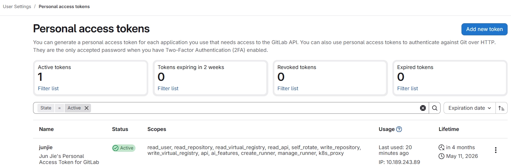
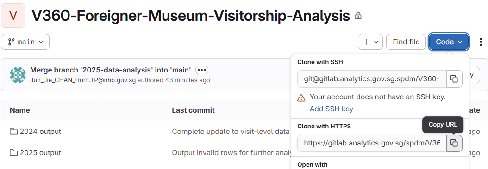
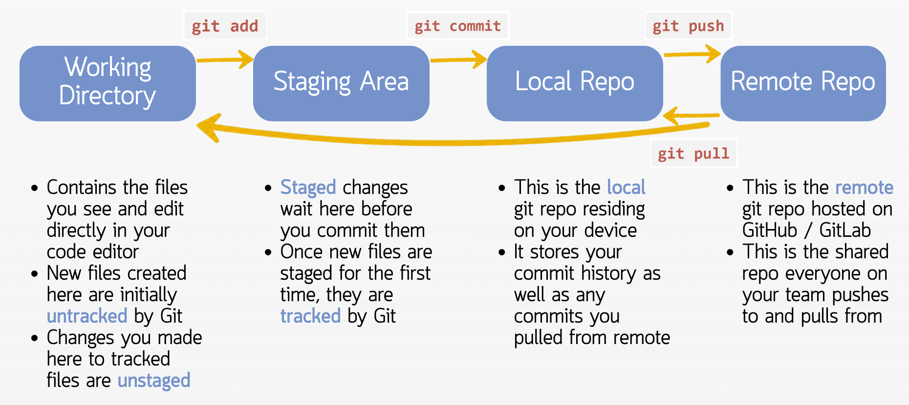
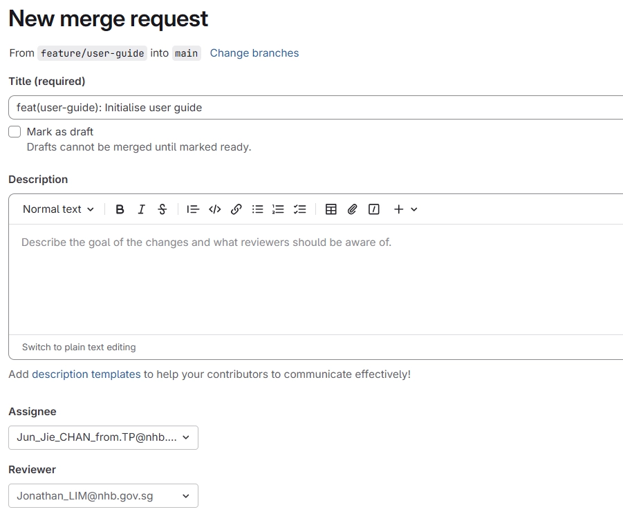

# Git Summary Notes

## 0. Linux and the Terminal

<aside>

The **terminal** (aka command line or shell) is a text-based interface for interacting with your computer. This is opposed to a graphical user interface like Windows Explorer that lets you click on folders to navigate.

**Linux** is an operating system kernel used in servers, cloud environments, and data engineering.  Bash is the language used in the terminal to run Linux commands.

A **Shell** is a program that reads commands you type, interprets them, and tells the OS kernel to execute them. The shell is the interface between you and the kernel.

We use the **Bash** shell. Bash is two things simultaneously:

1. **A command interpreter:** reads commands you type line by line and executes them
2. **A programming language:** has variables, conditionals, loops, and functions, so you can write scripts (`.sh` files) that automate sequences of commands 
- We write our Linux commands in **Bash**. 
Note: Bash is case-sensitive.
</aside>

### Useful Terminal Commands

- Many of the commands in the following sections require you to be in the correct working directory

| `pwd` | Show the path to your **present** working directory |
| --- | --- |
| `ls` | List files in current directory |
| `ls -a` | List all files including hidden ones (e.g. `.git` folder) |
| `ls -la` | List all files with details (permissions, size, date) |
- In Bash, `-` and `--` are used to pass **flags** to commands. Flags modify how a command behaves.
    - **Double dash `--`** is used for long-form flags that are full words. These are more readable and self-explanatory:
        
        ```bash
        git log --oneline        # no short form version
        git commit --amend       # no short form version
        ```
        
    - **Single dash `-`** is used for short, single-character flags. Many long-form flags have short versions. You can also chain multiple single-character flags together
        
        ```bash
        ls -a          # show hidden files (short for --all)
        ls -l          # show detailed list
        ls -la         # both combined
        ```
        
    - To find documentation on what flags are available, see [Git - Reference](https://git-scm.com/docs)
    Alternatively, run `<command> --help`, e.g. `git commit --help`, `git push --help`. Note: This may not work on Analytics@Gov as the command manuals are not available.

**Navigation**

- Use these commands to navigate to the correct location before using git commands

| `cd <folder>` | Move into a folder or path |
| --- | --- |
| `cd ..` | Move up (back) one folder |
| `cd ../<folder>` | Move up (back) one folder then enter a folder or path there |
| `cd ~` | Go back to your home directory (e.g. for analytics@gov its `/home/jovyan`) |
| `cd /` | Go back to your root directory (`/`) |
| `cd -` | Go back to the previous directory you were in (back button) |

**Working with files and folders**

| `mkdir <folder>` | Create a folder in the present working directory |
| --- | --- |
| `touch <file>` | Create a new empty file |
| `cp <file> <destination>` | Copy a file to the destination path |
| `mv <file> <destination>` | Move a file to the destination path |
| `rm <file>` | Delete a file |
| `rm -r <folder>` | Recursively delete a folder and everything in it
⚠️ There is no recycle bin for the terminal. `rm` permanently deletes files immediately. |

| `clear` | Clear the terminal screen (deletes all lines) |
| --- | --- |
| `history` | Show command history |

**Useful Terminal Keyboard Shortcuts**

| `Tab` | Autocomplete a file or folder name |
| --- | --- |
| `↑` / `↓` | Scroll through previous commands |
| `Ctrl + C` | Cancel a running command |
| `Ctrl + L` | Clear the terminal screen (by moving your cursor and screen view to the bottom, without actually clearing the lines) |
| `Ctrl + A` | Jump to the start of line |
| `Ctrl + E` | Jump to the end of line |

## 1. Git Environment Setup

<aside>

**Configure your Git identity**

```bash
git config --global user.name "short_username"
git config --global user.email "your_email@agency.gov.sg"

# set your default terminal text editor for git commit
git config --global core.editor nano
```

**Verify your config** 

```bash
git config --list
```

</aside>

<aside>

**Set up your Gitlab Personal Access Token (PAT)**

- GitLab → Profile Avatar (top-right) → Edit profile → Click the menu dropdown at the top-left of your screen → Access → Personal access tokens
    
    
    
    - Scopes needed: `read_repository`, `write_repository` (actually best to just tick all)
        - Scope also mean “Access Control” parameters (i.e. what actions you can do)
    - These scopes set the permission levels granted, which allow the PAT to authorise certain actions
- Store it somewhere safe, Gitlab will not show you this code again
- PAT is required for pushing and pulling from Gitlab
</aside>

<aside>

**Storing and referencing your PAT when pushing / pulling**

- **Options available for use with Analytics@Gov**
    1. **Using a .txt file (Notepad)**
        - Simply store your PAT in a .txt file on disk and copy paste from it every time you need it.
        - This is not secure as its left unencrypted and out in the open.
        - Alternatively, save it in a google docs / word somewhere online. This is still inconvenient and troublesome to copy paste your PAT every time
    2. **Git credential store**
        - `git config --global credential.helper store`
        - After running this command, you will **still need to authenticate your next push/pull with your username + PAT once**, but they will then be stored in **plaintext** to `~/.git-credentials` (in your home directory on Analytics@Gov)
        - Subsequently, whenever these credentials are needed, git will automatically read from the saved file
        - This method is persistent across sessions but is not that secure as your PAT is stored unencrypted, in your analytics@gov home directory. However, this way is more convenient than the .txt method as you don’t need to copy paste your PAT every time.
        
        **If you update your PAT**, simply delete the `.git-credentials` file in your jovyan home directory, and rerun `git config --global credential.helper store`
        
- **Other more secure options**
    1. **OAuth via git-credential-manager**
        - **Windows**: git-credential-manager is automatically packaged with an installation of git. However, curiously it is not available in analytics@gov and can’t be installed there. For Mac and Linux devices, this needs to be downloaded separately.
        - **Steps**
            1. **Point git at GCM**
            On macOS and Windows the installer does this automatically — on macOS you don't need to run git config because GCM configures Git for you.
            
            ```bash
            # To do it explicitly
            git-credential-manager configure
            
            # verify
            git config --global --get-all credential.helper   
            # should show "manager"
            ```
            
            1. **Clear any old PAT stored using `git credential store` or `cache`**
            
            ```bash
            git credential-store erase
            ```
            
            1. **Trigger the OAuth flow once manually**
            E.g. using git clone, git push or git pull. You will need to authenticate on GitHub/GitLab once. Subsequently, all further HTTPS operations are automatically authenticated, while your PAT stays secure. 
</aside>

## 2. Cloning a repository

<aside>

**Terms:**

- **Remote repo**: The version of your repository hosted on GitLab / Github. This is the central copy that your whole team pushes to and pulls from.
- **Local repo**: The version of your repository on your own machine. This is where you make changes before pushing them up to the remote.
</aside>

<aside>

**Clone an existing GitLab repo**

- Do this once per project to get a remote GitLab repo onto your machine.
- You can copy the HTTPS address from Gitlab



```bash
git clone https://<your-gitlab-instance>/<team>/<repo>.git
```

- This saves the repo as a folder in your current working directory
</aside>

<aside>

**Alternatively, initialise a git repo locally, then link to GitLab**

1. **Initialise a git repo locally**
    
    ```bash
    git init
    git branch -m master main  # rename the "master" branch to "main"
    
    git add .
    git commit -m "initial commit"
    ```
    
    - Note: `git init` by default sets the first branch in the newly initialised repo to be called `master`. Nowadays, it is standard to name the main branch `main`
2. **Create an empty repo on GitLab**
    - GitLab → Create Project → Create blank project → uncheck "initialise with README”
    - This ensures the remote repo is created empty, else there will be an error when you try to link to your git repo and you will not be able to push your local repo to Gitlab
3. **Link your local repo to GitLab and push**
    - Get the HTTPS address from Gitlab and use `git remote add origin <HTTPS address>` to link the local repo to GitLab
    
    ```bash
    git remote add origin https://<your-gitlab-instance>/<team>/<repo>.git
    git push -u origin main  # push the local main branch to remote
    ```
    
</aside>

<aside>

**Check your remote is configured correctly**

```bash
git remote -v
```

**Expected output:**


These should match the url of the repo on Gitlab (without the .git):


</aside>

## 3. Local Workflow

<aside>

#### The 4 Areas of Git



</aside>

<aside>

**Git commands (main)**

```bash
git add <file>                    # stage a specific file
git add file1 file2 file_n        # stage a variable number of files at once
git add .                         # stage everything
git commit -m "commit message"    # commit staged changes
```

**Other commit commands**

```bash
git commit       # opens a nano window for you to write multi-line commit messages
git commit --amend -m "corrected message"    # rewrite message for the last commit
git commit --amend --no-edit    # add your staged changes into the last commit, keeping its message
```

- **How to write multi-line commit messages?**
    
    <aside>
    
    Run `git commit` just like that to open a nano window for writing the commit message
    
    
    
    Write your multi line message in the space provided
    
    
    
    Press `Ctrl + X` to exit the nano window, then `Y` to save and `Enter` to confirm. If a commit message has been written, it will commit
    
    </aside>
    
</aside>

<aside>

**Checking State**

```bash
git status                     # see what's changed
git status --ignored           # also list files ignored by .gitignore
git status -u                  # list every untracked file, instead of collapsing untracked folders
```

- `git status` shows which files have been staged or committed. Use this to check which files will be affected before you push
- It can also be used to check if the current folder is a local git repository

```bash
git log                        # view commit history
git log --oneline              # view commit history (condense each into one line)
git log -n <number>            # only show the latest <number> commits
git log --oneline --graph      # with lines showing where work split and merged
git log --oneline --graph --all   # same, for all branches
git log --oneline --first-parent  # only commits made directly on this branch, e.g. one per MR merged into main
```

```bash
git diff                       # see exactly which lines changed in unstaged files
git diff <file>                # same, for one file
```

- Tip: `git log` and `git diff` open in a scrollable viewer when the output doesn't fit on your screen. Use `↑` / `↓` to scroll, and press `q` to quit

</aside>

<aside>

**Ignoring Files**

We can tell Git which files and directories to ignore in a given repository, using a `.gitignore` file. This is useful for files you know you NEVER want to commit, including:

- Secrets, API keys, credentials (e.g. `.env`)
    - If you pushed a secret by accident, treat it as leaked and revoke it immediately. Undoing the commit does not remove it from GitLab’s history (see Section 7)
- Operating System files (`.DS_Store` on Mac)
- Log files (`*.log`)
- Dependencies & packages (e.g. `node_modules/` for node applications, `__pycache__/` for python)
- `.venv/` , `.ipynb_checkpoints/`
- **Syntax**
    
    ```bash
    # This is a comment
    
    # Ignore a specific file
    test.py
    
    # Ignore all files of a specific file type (.csv)
    *.csv
    
    # Ignore a whole folder
    data/
    
    # Ignore a folder's contents but not the folder itself
    data/*
    
    # Ignore everything in a folder except one file 
    # (order of entries DOES matter, put your exceptions after the wide ignore)
    data/*
    !data/keep_this.csv
    
    # Ignore a file only in the root directory
    /config.json
    
    # Ignore a file in any subdirectory
    **/config.json
    ```
    
- **Sample `.gitignore`**
    
    ```bash
    __pycache__/
    
    # Do not save input data
    *.csv
    *.xlsx
    
    # But DO save output data
    # Output data is usually exported to a folder named f"{YEAR} output"
    !*output/*.csv
    !*output/*.xlsx
    
    # Note: *output/ refers to any folder with name ending in "output"
    # so a folder named "2024 output" would get caught
    ```
    

```bash
# Show which line of which .gitignore is causing a file to be ignored
git check-ignore -v <file>
```

```bash
git rm --cached <file>         # stop tracking a file, without deleting it from your machine
git rm -r --cached <folder>    # same, for a whole folder
```

- Adding an already committed file to `.gitignore` does not stop Git tracking it. Run this to stop tracking it without deleting it from your machine, then commit

</aside>

<aside>

**Git and Jupyter Notebooks**

- A notebook (`.ipynb`) looks like cells in the UI, but underneath it is one big JSON file holding your code, cell outputs (including charts), execution counts and metadata
- Running cells marks the notebook as modified, even if you didn’t change any code, as the execution counts, outputs and metadata saved in the file change
- Use `git diff <notebook>` or the VSCode diff view to check what changed, and `git restore <notebook>` to discard changes from just running it
</aside>

<aside>

**Using the VSCode / JupyterLab Git UI**

- The VSCode IDE on analytics@gov has a UI for Git, accessible from the left sidebar. JupyterLab has a similar one
- You can stage / unstage files one by one, which is convenient when you only want to stage certain files within certain folders
- You can write your commit message and commit from the left sidebar
- Clicking a changed file shows a diff that highlights all deletions and additions
</aside>

## 4. Remote Workflow

<aside>

```bash
git push
```

- Push committed changes to GitLab

```bash
git push -u origin <branch>
```

- **When pushing from any new branch for the first time**, you must run this to set `<branch>` as the upstream branch to push to
    
    <aside>
    
    - `-u` : short for `--set-upstream`. This tells Git to remember the relationship between your local branch and the remote branch, so that future pushes and pulls on this branch only need `git push` or `git pull` with no extra arguments.
    - `origin` : the name of the remote you're pushing to. This is the alias for your GitLab repo URL, set when you cloned or ran `git remote add origin <url>`. So you do not have to rewrite the whole url.
    - `<branch>` : name of the branch you are pushing, e.g. `main`, `feature/user-guide`. This creates the branch on the remote if it does not exist yet.
    </aside>
    

### **Fixing problems preventing you from pushing**

<aside>

**Git does not allow you to push local changes to a remote branch that is ahead of your local branch**

- If the remote branch has commits that your local branch does not have, the remote branch is ahead of your local branch by that many commits, e.g. because your teammate pushed some changes to that branch

**Solution:**

- **Pull the remote changes first**. Then your local branch is strictly ahead of remote (by your latest changes). You can then push as normal.
</aside>

<aside>

**No upstream branch set**

- Occurs on the **first** push of a branch you created locally, or of a brand new local repo you linked with `git remote add`
- Your local branch is not linked to any remote branch yet, so a plain `git push` does not know where to push to
- Git throws `fatal: The current branch <branch> has no upstream branch.`

**Solution:**

- Push once with `git push -u origin <branch>`. This links your local branch to the remote branch, creating it on the remote if it does not exist yet
- After that, a plain `git push` / `git pull` works
</aside>

<aside>

**The branch is protected on GitLab**

- A **protected branch** only accepts changes in approved ways, usually through a merge request. Repo owners protect `main` so that nobody can push unreviewed changes straight into production
- Git throws `remote: GitLab: You are not allowed to push code to protected branches on this project.`

**Solution:**

- Push your commits to a separate branch instead, then open a merge request to merge it into `main` (see Section 6)
- If you already committed on local `main` by mistake, move those commits to the correct branch first (see Section 9 on accidentally making changes on the wrong branch)
</aside>

<aside>

**Unrelated commit histories between branches / repos**

- Occurs when Git is asked to combine two branches / repositories with that **do not share a common ancestor commit**
- Git will not allow this as it cannot treat one commit history as a continuation of the other
- E.g. You have a project folder which you just initialized with a git repo. You then create a new Gitlab repo, while mistakenly ticking the option to add a README. You  `git remote add <...>` to link the 2 repos
    - When you try to git push the code, Git throws `error: failed to push some refs to '...' hint: Updates were rejected because the remote contains work that you do not have locally.` because of the README added when the Gitlab repo was created.
    - When you try to git pull to get the README, Git throws `fatal: refusing to merge unrelated histories`

**Solution:**

- Insist on pulling remote changes, then push your local changes as normal
    
    ```bash
    git pull origin main --no-rebase --allow-unrelated-histories
    git push -u origin main
    ```
    
    - `origin main` : your new local branch has no upstream yet, so you need to say which remote branch to pull from
    - `--no-rebase` : combine the two histories with a merge (see divergent branches below)
    - `--allow-unrelated-histories` : tells Git to merge even though the two histories share no common commit
- To avoid this entirely, untick “Initialise with README” when creating a GitLab repo for an existing local project
</aside>

</aside>

<aside>

```bash
git pull
```

- Fetches and merges the equivalent <u>**remote branch**</u> into your <u>**local branch**</u>, equivalent to running both `git fetch` and `git merge`
    - Note: if you are on a feature branch, say `model/xgboost`, git pull fetches and merges the changes to the remote `model/xgboost` and merges them into your local branch,
- Before starting work, always run `git pull` while on the local main branch to make sure you are working with the latest version of the codebase.

```bash
git pull origin main
```

- Run to explicitly fetch and merge changes **from `main` into your current branch.**
- Before continuing work on a feature branch, always run `git pull origin main` to make sure you pull any new commits your teammates merged into main.

### **Fixing problems preventing you from pulling**

<aside>

**Git does not allow you to pull remote changes that would cause a merge conflict with your local <u>uncommitted</u> changes**

- E.g. You run a notebook, which causes uncommitted changes to its metadata regardless of whether there were any changes to exported output. A teammate then pushes code to that branch which you try to pull.
- Normally, when merging (e.g. through git pull), Git will automatically merge changes if possible and prompt you to address merge conflicts if necessary, between your local <u>**commits**</u> and remote changes
- However, it will not allow you to pull remote changes that would cause a merge conflict with your local <u>**uncommitted**</u> changes
- Note this applies per file, not per line. Even if your edits are on different lines, Git will stop the pull

**Solutions:**

1. **Commit your local changes**. Then you can pull remote changes and then Git will allow you to manually resolve merge conflicts.
2. **Discard your local uncommitted changes** using `git restore .`
3. **Stash your local uncommitted changes using** `git stash` if you don’t want to discard them. Then you can pull remote changes, and `git stash pop` to retrieve your uncommitted changes.
</aside>

<aside>

**Your local and remote branches have diverged**

- Your local branch has commits the remote does not have, **and** the remote has commits you do not have, e.g. you and a teammate worked on the same branch at the same time
- Git throws `fatal: Need to specify how to reconcile divergent branches.`

**Solutions:** choose how to combine the branches (for this one pull only)

```bash
git pull --no-rebase    # merge: combines both branches with a new merge commit
git pull --rebase       # rebase: replays your local commits on top of the remote's commits
```

- `--no-rebase` : the history shows where the work split and joined back together. nano opens with a pre-filled merge message, save and exit to accept it
- `--rebase` : the history stays a straight line, with no merge commit
- Only rebase commits you have **not** pushed yet, as rebasing rewrites them
</aside>

<aside>

**An untracked local file would be overwritten**

- A teammate pushed a **new** file, and you have an **untracked** file with the same name in the same folder. Git will not overwrite a file it is not tracking, even if both files have identical contents
- E.g. You and a teammate each create a `.gitignore`, and they push theirs first
- Git throws `error: The following untracked working tree files would be overwritten by merge`

**Solutions:**

1. **Rename your file** if you want to keep it, then `git pull`
2. **Delete your file** if you don’t need it, then `git pull`. Note untracked files are not saved in Git, so deleting one is permanent
</aside>

</aside>

<aside>

```bash
git fetch
```

- Updates your local knowledge of what remote branches are on Gitlab
- Essentially it only downloads remote changes, but unlike `git pull`, it does not merge the changes, so it does not touch your working directory
- **Sample output**
    
    
    
    - This shows there is currently only the `main` branch on the remote repo
</aside>

### Conflict Resolution

<aside>

### Merge Conflicts

A merge happens whenever two lines of development need to be combined:

- When you run `git pull` (this combines fetch + merge)
- When you accept a MR on GitLab
- When you run `git merge` directly in the terminal
- Note: `git push` can never cause a merge conflict as Git will not allow you to push if the remote branch is ahead of your local branch (you will have to pull first)

This can result in a **merge conflict** if two branches changed the same part of the same file and Git cannot automatically merge them. You will have to manually resolve this.

</aside>

<aside>

### Resolving Conflicts

- Git will mark the conflicting lines in affected file(s):
- I recommend using the VSCode (code server) view provided by analytics@gov for this as it provides a readable UI to compare changes when resolving merge conflicts

**VSCode view:**


1. Open the file and decide what the final version should look like
2. Remove all the conflict markers (`<<<<<<<`, `=======`, `>>>>>>>`)
3. Save the file, then:
    
    ```bash
    git add <file>
    git commit -m "fix: resolve merge conflict in <file>"
    ```
    
    - Alternatively, run `git commit` and nano opens with a pre-filled merge message. Save and exit to accept it
- In VSCode, you can click `Accept Current Change` / `Accept Incoming Change` / `Accept Both Changes` above each conflict instead of editing the markers manually
- If you get lost in the middle of a merge, run `git merge --abort` to cancel the merge and go back to how things were before you pulled
</aside>

<aside>

### Rebase Conflicts

- A rebase replays your commits one by one, so you may get a conflict on any of them
- Resolve it as usual and run `git add <file>`, then `git rebase --continue` instead of `git commit`
- Run `git rebase --abort` to cancel the rebase

</aside>

<aside>

**Types of conflicts**

| Merge conflict | fix → `git add` → `git commit` ✅ |
| --- | --- |
| Rebase conflict | fix → `git add` → `git rebase --continue` ✅ |
| Cherry-pick conflict | fix → `git add` → `git cherry-pick --continue` ✅ |
| Stash pop conflict | fix → `git add` → `git stash drop` ✅ (no commit needed, the stash is not removed automatically when there is a conflict) |
</aside>

## 5. Branching

<aside>

**Git Commands**

- Use `git branch` to list your local branches, it will **highlight your current branch**

```bash
git branch                    # list local branches
git branch -a                 # list all branches including remote branches

git branch <branch>           # create a new local branch named <branch>

git branch -d <branch>        # delete a branch locally
git branch -D <branch>        # FORCE delete a branch locally (even if not merged)
git push origin -d <branch>   # delete a branch on the remote (*dangerous*)

git branch -r                 # list remote branches
git fetch --prune             # also clear Git's record of remote branches that were deleted
```

```bash
git switch <branch>            # switch to an existing local branch
git switch -c <branch>         # create and switch to a new branch (from current)
git switch -c <branch> main    # create and switch to a new branch (from main)
```

- **If you are creating a new feature branch, make sure to branch off from main!**
    
    <aside>
    
    - This means you should `git switch main` then `git switch -c <new-branch>`
    - or `git switch -c <new-branch> main`
    - Otherwise, you will be branching from your current branch, which may or may not be what you are intending, so be aware.
    </aside>
    
- **Switching branches with uncommitted changes**
    
    <aside>
    
    - Uncommitted changes (staged or not) do not belong to any branch, they only exist in your working directory. So they follow you when you switch branches
    - However, if the file is different on the other branch, switching would overwrite your uncommitted changes, so Git refuses and keeps you where you are:
    `error: Your local changes to the following files would be overwritten by checkout`
    - To switch, commit your changes first, or stash them (see Git Stash below)
    </aside>
    
- FYI, an older alternative command: `git checkout`
    - This is an older command that is considered overloaded as it does a lot of different things
    - `git switch` and `git restore` were subsequently introduced to split apart `git checkout`‘s roles, so it is best to use them instead
    - FYI as many older tutorials still teach `git checkout`
    
    ```bash
    # 1. Switching branches
    git checkout <branch>
    
    # 2. Creating a branch and switching
    git checkout -b feature/new-dashboard
    
    # 3. Restoring a file
    git checkout -- <file-path>
    
    # 4. Detached HEAD state
    git checkout abc1234        # a commit hash, not a branch name
    ```
    

**Accessing remote branches with fetch**

- If you currently do not have a copy of the remote branch locally, running `git switch` to access the remote branch will not work as your local repo has no knowledge of the remote branch
    
    <aside>
    
    **Example:**
    
    - Your teammate pushed a feature branch “hyperparameter-tuning” to remote
    - They told you they did that, and you are to continue working on their branch
    - If you simply run `git switch hyperparameter-tuning`, it will not work as your local repo has no knowledge of that remote branch. Running `git branch` will also not show that branch.
    - After running `git fetch`, this downloads all new remote changes, and gives you local branches (of those remote branches)
    - You can now `git switch` to the new feature branch locally or use `git branch` to see them
    </aside>
    
    - To fix this, run `git fetch`:
        - This shows you what remote branches are in Gitlab
        - Also updates your local knowledge on what remote branches are on Gitlab, so that you can run `git switch <branch>` to access a local copy of the remote branch
- **Why not just run `git pull`?**
    
    <aside>
    
    - `git pull` fetches all remote changes **and <u>merges remote changes for your current branch</u>**, which may be an extra step you don’t want to do yet.
    - `git fetch` only downloads everything from the remote for all new branches and commits, giving your local repo full knowledge of what exists on GitLab, so that you can access a local copy of the new remote branch without affecting the local branch you were previously working on
    </aside>
    
</aside>

<aside>

**Branch Naming Convention**

- `main`: The main development branch
- `feature/` (or `feat/`): For new features (e.g. `feature/add-login-page`)
- `fix/`: For bug fixes (e.g. `fix/header-bug`)
- `hotfix/`: For urgent fixes (e.g. `hotfix/security-patch`)
- `release/`: For branches preparing a release (e.g. `release/v1.2.0`)
- `chore/`: For non-code tasks like dependency, docs updates (e.g. `chore/update-dependencies`)
</aside>

<aside>

**Example workflow for working on a feature**

```bash
# 1. Switch to local main, and pull the most recent remote main
git switch main
git pull origin main

# 2. Create and switch to a new feature branch
git switch -c feature/visitor-forecast-model

# 3. Do your work, then stage and commit your changes
git add .
git commit -m "model(sarimax): add SARIMAX baseline for visitor forecasting"

# 4. Push your local branch to remote
git push origin feature/visitor-forecast-model

# 5. Open a Merge Request (GitLab) / Pull Request (GitHub) from the browser
```

</aside>

<aside>

**Why use branching?**

- Branching lets you create a separate line of work that diverges from `main` without affecting it.
- This allows you to:
    - work on something unfinished without breaking what already works
    - if something goes wrong, you can simply delete the branch instead of having to manually find and revert bad changes
    - many people can work in parallel without getting in one another’s ways
- `main` should always be in a working state (production). Branches are for development of messy or work in progress
- See [Conventional Branch](https://conventionalbranch.org/) for more information
</aside>

### Working Across Branches

<aside>

**Merging Branches**

```bash
git merge main                     # merge local main into your current branch
git pull origin main --no-rebase   # merge the latest remote main into your current branch
git merge --abort                  # cancel a merge in progress
```

- While you work on your feature branch, your teammates keep merging their work into `main`. The longer you wait to bring those changes into your branch, the further behind it falls, and the bigger the merge conflicts you risk later
- This is the only kind of merge you should do yourself. **Never** merge your branch into `main` with `git merge`. Instead, open a merge request on GitLab, so only reviewed code is merged into `main` (see Section 6)
- If you get a merge conflict, resolve it as in Section 4 (Conflict Resolution)

<aside>

- **Example**
    - A teammate’s merge request was merged into `main`, and it changed the same file you are working on
    - Update your local main, then merge it into your feature branch:
    
    ```bash
    git switch main
    git pull
    git switch <your-branch>
    git merge main      # resolve any merge conflicts
    git push
    ```
    
</aside>

</aside>

<aside>

**Rebasing onto main**

```bash
git rebase main      # replay your current branch's commits on top of the latest main
git rebase --abort   # cancel a rebase in progress
```

- `git rebase main` is an alternative to `git merge main` for bringing your branch up to date
- It sets your commits aside, moves your branch to the latest commit on `main`, then replays your commits on top, one by one
- Always switch to the branch you want to move **first**, then name the branch you want to move it onto
- Your commits keep the same messages and changes, but get **new hashes**, as rebasing creates new copies of them. So only rebase commits you have **NOT** pushed yet. Never rebase a branch your teammates are also working on (a git mess!)

|  | `git merge main` | `git rebase main` |
| --- | --- | --- |
| History | Adds a merge commit, showing where the work split and joined | Straight line, no merge commit |
| Your commits | Kept as they are | Replaced with new copies (new hashes) |
| Safe on pushed branches? | Yes | No |
</aside>

<aside>

**Applying commits**

```bash
git cherry-pick <hash>                  # Apply the commit to the current branch
git cherry-pick <hash1> <hash2> <hash3> # You can apply many commits at a time
```

- `cherry-pick` creates **new commit(s)** with the changes applied by the commit(s) given
- **Available flags:**
    
    <aside>
    
    - By default, the new commit(s) will have the same commit messages as the original(s).
    Use `--edit` to specify a different commit message for one commit
    - Cleaner way to apply commits: `git cherry-pick **--no-commit** <hashes ...>`
        - `--no-commit` applies the commits to your workspace and stages them. Once you are ready, you can commit your code as normal
    - `-x` : appends a line to the commit message like `(cherry picked from commit abc1234)`, so anyone can trace the original branch’s commit easily
    </aside>
    

<aside>

- **Example**
    - You committed a fix on `feature/a`, and you also need it on `feature/b`
    
    ```bash
    git log --oneline        # on feature/a, copy the hash of the fix commit
    git switch feature/b
    git cherry-pick <hash>   # apply the fix commit to feature/b
    ```
    
    - To **move** a commit to the correct branch instead, see Section 9 on accidentally making changes on the wrong branch
</aside>

</aside>

<aside>

**Git Stash**

- Use `git stash` to temporarily set aside **uncommitted changes** without committing them.

```bash
git stash                  # stash your current uncommitted changes
git switch <other-branch>

# -------------------------------------------------- #
# do your urgent work in another branch... ╭(•ᴗ•)╮
#                                           _| |_
# -------------------------------------------------- #

git switch <your-branch>
git stash pop              # restore most recent stash and remove from stash list
```

- Stashing is a way to temporarily set aside **uncommitted** changes without committing them. It's useful when you are in the middle of working in one branch but urgently need to attend to another branch.
- By default, `git stash` captures **modified tracked files and staged changes**, but not untracked files (new files you haven't `git add`ed before) and git ignored files.

| `git stash` | Saves your local modifications away and reverts the working 
directory to match the `HEAD` commit.
(Note: Untracked files like newly added files are not included) |
| --- | --- |
| `git stash -u` | Also include untracked files |
| `git stash push -m "message"` | Also include a message to tell stashes apart |
| `git stash list` | Shows all your stashes |
| `git stash pop` | Restore **most recent** stash and <u>**remove**</u> from stash list |
| `git stash apply` | Restore **most recent** stash <u>**without removing**</u> from stash list |
| `git stash pop stash@{n}`
`git stash apply stash@{n}` | Same as above, but for a specific stash entry, e.g. `stash@{1}` (find `n` with `git stash list`) |
| `git stash drop`
`git stash drop stash@{n}` | Delete the most recent stash entry
Delete a specific stash entry |
| `git stash clear` | Delete all the stash entries. Note that those entries will then be subject to pruning, and may be impossible to recover |
- `stash@{0}` is always the most recent stash
- If `git stash pop` gives a merge conflict, resolve it as usual and `git add <file>`, then run `git stash drop`. When there is a conflict, the stash is not removed from the list automatically
</aside>

## 6. Merge Requests and Code Review

<aside>

As we learnt from Section 5 on Branching, we do not commit our changes straight to `main` to prevent any bad changes from making it straight into production.

Instead, we work on feature branches, until we finish a feature or set of specific changes. Once we are happy with it, we will merge our feature branch into main to merge in our changes.

- **The workflow for doing this is as follows:**
    
    <aside>
    
    1. **We create a feature branch off main, say `pipeline/add-models`**
    2. **We work on our changes in the branch, staging and committing changes locally as we go**
        - By commiting changes, they are tracked locally in your local git repo
        - Your teammates cannot see them yet, as all they can see is their own local repo, and the remote repo on GitLab
    3. **Once we are done (or any time in between commits), we can push our commits to remote**
        - This pushes the feature branch to the remote repo on GitLab where everyone in the team can see the code
        - They can see the changes on the web, or even pull the branch to work on the code locally
    4. **Before opening a merge request, we merge the latest `main` into our feature branch locally**
        - This way, any merge conflicts are resolved on our machine and don’t reach GitLab (see Section 5 on Merging Branches)
    5. **To merge the feature branch into `main` (or any other branch), we open a merge request on GitLab from our browser.**
    6. **A reviewer, typically someone else on the team, will go through the changes in the feature branch**
        - They can leave comments, approve or disapprove the merge request
        - If the merge request is approved, the feature branch's changes can be merged into main
        - This updates the main branch remotely, and other team members need to pull the main branch to get the changes locally.
    </aside>
    
</aside>

<aside>

### **Author: Opening a MR for branch → main**

- **GitLab**
    1. Push your branch to remote using `git push` (or `git push -u origin <branch-name>` if pushing from a new feature branch for the first time)
    2. Go to the repo page on GitLab, a prompt should appear immediately and persist for recent pushes to the remote repo
        
        
        
        Or if the prompt is not there anymore, create the MR manually
        `GitLab → Your repo → **Merge Requests → New Merge Request**`
        
    3. Set **source branch** to the feature branch, and **target branch** to `main`
        
        
        
    4. Fill in the MR description
    5. Assign a Reviewer
    6. Click **`Create Merge Request`**
- **GitHub**
    
    Merge requests are called <u>**Pull requests (PR)**</u> in GitHub. Otherwise, PRs in GitHub are essentially the same thing as in GitLab
    
    1. Push your branch using `git push` (or `git push -u origin <branch>` if pushing from a new feature branch for the first time)
    2. Go to the repo page on GitHub, a prompt should appear immediately
        
        
        
        Or if the prompt is not there anymore, create the PR manually
        `GitHub → <Your repo page> → "Pull requests" tab → "New pull request" button`
        
        
        
    3. **base** should be `main` and **compare** should be the feature branch you are merging
        
        
        
    4. Fill in the PR description
    5. Assign Reviewer(s)
    6. Click **`Create pull request`**
</aside>

<aside>

**Author: Tidying your commits before opening an MR**

- While working, you will often end up with messy commits like `wip` or `fix typo`. Before opening a merge request, you can tidy them up so your reviewer sees a clean, readable history

```bash
git rebase -i HEAD~<n>    # tidy up your last <n> commits
git rebase --abort        # cancel the rebase
```

- `-i` stands for **interactive**. `HEAD~<n>` means “the last `<n>` commits”
- nano opens a to-do list with one line per commit, **oldest first** (the opposite order from `git log`)
- Change the word at the start of each line to tell Git what to do with that commit, then save and exit. Git then carries out the list from top to bottom

| `pick` | Keep the commit as it is |
| --- | --- |
| `squash` | Combine the commit into the commit above it, and edit the combined commit message |
| `fixup` | Same as `squash`, but discard this commit’s message |
| `reword` | Keep the commit, but change its commit message |
| `drop` | Delete the commit, including its changes |
- Just like `git rebase`, this creates new commits with new hashes, so **only use it on commits you have NOT pushed yet**
- If you dropped a commit by mistake, you can get it back with `git reflog` (see Section 7)
</aside>

<aside>

**Author: Merge conflicts in an MR**

- While your MR was being reviewed, a teammate’s MR that changed the **same lines** was merged into `main` first. Your MR now shows:
    
    > ⚠️ **Merge blocked:** merge conflicts must be resolved.
    `Resolve conflicts` `Resolve locally`
    
- The `Merge` button is disabled until the conflict is resolved. There are 2 ways to fix it:
1. **Resolve on GitLab**
    - Click `Resolve conflicts`, choose which version to keep for each conflict, then click `Commit to source branch`
    - This commit was made on GitLab, not on your machine, so your local branch is now behind. Run `git pull` to update it
2. **Resolve locally**
    
    ```bash
    git switch main
    git pull
    git switch <your-branch>
    git merge main          # resolve the merge conflicts (see Section 4)
    git add <file>
    git commit              # save and exit nano to accept the pre-filled merge message
    git push
    ```
    

|  | Resolve on GitLab | Resolve locally |
| --- | --- | --- |
| Speed | Fast, a few clicks | More steps |
| Can you run or test the result? | No | Yes |
| Works for every conflict? | Only simple text conflicts (not notebooks, renamed files or large conflicts) | Yes |
| Afterwards | Your local branch is behind, so you must `git pull` | Nothing else to do |
</aside>

<aside>

### **Reviewer: Reviewing a MR**

This process is the same for MRs on GitLab and PRs on GitHub

```bash
git fetch
git switch <branch-name>
```

1. Run `git fetch` to get local knowledge on what remote branches are on GitLab
2. Run `git branch -r` to list the remote branches
    - You will see something like `origin/<branch-name>` 
    (origin is the alias for the remote address)
3. Run `git switch <branch-name>` to get a local copy tracking the remote branch
    - For example, typing `git switch fix/sarimax-bug` (without the prefix `origin/`)
    - The output looks likes below
    
    ```
    branch 'fix/sarimax-bug' set up to track 'origin/fix/sarimax-bug'.
    Switched to a new branch 'fix/sarimax-bug'
    ```
    
4. Now that you have a local copy of the branch, run the code and make sure all the objectives are met
5. Approve / reject the merge request and leave comments

Notes:

- If you run a brand new `git clone <repository>` , the newly cloned repository will have all the branches and commits from the remote repository. By running `git branch -r` will list all remote repositories at the time of `git clone`.
- Looking at `git branch -r` output `origin/fix/sarimax-bug`, do remember to delete the prefix `origin/` when switching branches. At local repository, the branch name will look like `fix/sarimax-bug`
</aside>

<aside>

### **Assignee: The one who actually merges**

- Could also be the Author or Reviewer
- From the Author perspective and if you want your code to be reviewed, set the `Assignee` to `Reviewer` right after the Pull Request is created. This is to trigger a notification to the `Reviewer` via GitHub or Email
</aside>

<aside>

**Assignee: Merging the MR**

- Before clicking `Merge`, look at the options in the merge section:
    - Tick `Delete source branch`. Once merged, the feature branch is no longer needed, so GitLab deletes it for you
    - Leave `Squash commits` unticked. This would combine all the commits on the branch into 1 commit on `main`. Some teams prefer this to keep the commit history of `main` short
- Once merged, everyone updates their local `main`, and the author deletes their local feature branch:
    
    ```bash
    git switch main
    git pull
    git branch -d <branch>    # works as the branch has already been merged into main
    git fetch --prune         # clear Git's record of the deleted remote branch
    ```
    
- Run `git log --oneline --first-parent` on `main` to see one line for each merge request that was merged
</aside>

## 7. Safe Undo of Code Changes

<aside>

**Background info:**

- **Untracked** files are files that have never been staged to Git (`git add`), such as a new file or new pipeline outputs.
    - Git doesn't track their changes, and `git restore` ignores them.
    - Once you stage a new file, they become **tracked** by Git
- **Unstaged** changes are edits to tracked files that you have not staged yet. They exist only in your working directory.
- **Uncommitted** changes are **staged** changes you have not committed yet. They're held in the *staging area* until you commit them**.**
- **Committed changes** are saved permanently in the repo's history as a snapshot.
- **Pushed changes** are commits uploaded to a remote repo such as one hosted on GitHub, where other people can pull them.
</aside>

<aside>

### **Safe Undo**

| `git restore --staged <file>`
`git restore --staged .` | Unstage a specific staged file (keep changes)
Unstage all staged files in the current directory |
| --- | --- |
| `git restore <file>`
**`git restore .`** | Discard unstaged changes in a file (resets it to staged version)
**Discard all <u>unstaged</u> changes in working directory**
(these do not affect untracked changes) |
| `git clean -fd`
`git clean -nd` | Delete untracked files and folders
Dry run of the above command (shows what would be deleted) |
| `git reset --soft HEAD~1` | Undo last commit (keep changes staged) |
| `git reset --mixed HEAD~1` | Undo last commit (keep changes unstaged) |
| `git reset --hard HEAD~1` | Undo last commit (delete changes) |
| `git switch --detach <hash>`
`git switch -` | View the state of the repo at a previous commit (detached HEAD)
Go back to the branch you were on |
| `git reflog` | List everywhere HEAD has been on your machine, to recover “lost” commits |
| **`git revert <hash>`** | Revert a pushed commit by performing a new commit that **inverses** the input commit (safe for shared branches on remote as it adds a new commit instead of rewriting commit history) |
- **Never use `git reset` on commits that have already been pushed to a remote branch**, as this rewrites remote commit history that others may have already pulled, which will cause a git mess for your collaborators
- **Use `git revert` instead** as it undoes the change by adding a new commit rather than
rewriting remote commit history
</aside>

<aside>

- **Common cases for safe undoing of code changes**
    - First, run `git log --oneline` while in the desired branch to get a list of commit hashes.
        
        
        
    1. **You just want to <u>see</u> the code at the point of a specific commit**
        
        <aside>
        
        ```bash
        git switch --detach <commit-hash>
        git checkout <commit-hash>     # older alternative, does the same thing
        ```
        
        - This moves HEAD to that commit and updates your working directory to that snapshot. This is useful for quickly inspecting an old version of your project. You land in a **detached HEAD** state (where HEAD points at a commit instead of a branch, so any new commits you make here aren't on any branch). To leave and go back: `git switch -`
        </aside>
        
    2. **You want to go back completely and <u>discard everything after that commit</u>**
        
        <aside>
        
        ```bash
        git reset --hard <commit-hash>
        ```
        
        - `reset` moves the current branch pointer to `<commit>`
        - The `--hard` flag also forces the working directory and staging area to match it, so everything after that commit is thrown away.
        - **This is a destructive command**, those changes CANNOT be restored afterward.
        </aside>
        
    3. **You want to <u>undo the effect of just that one commit</u> but keep the rest of the commit history the same**
        
        <aside>
        
        ```bash
        git revert <commit-hash>
        ```
        
        - This creates a new commit that cancels out the changes made in the original commit
        - Use the flag `--no-edit` to skip the commit-message editor
        - Changed your mind? A revert is just a normal commit, so you can revert it too. The new commit is named `Reapply "<original message>"`
        - Note: A reverted commit is still in the history. If you pushed a password or API key, reverting the commit does **not** remove it from GitLab. Treat it as leaked, and revoke it immediately
        </aside>
        
    4. **You want to <u>undo</u> the last commit but <u>KEEP the changes</u> in your working directory**
        
        <aside>
        
        ```bash
        # CHOOSE ONE:
        # undo last commit, keep changes STAGED
        git reset --soft HEAD~1    
        
        # undo last commit, keep changes UNSTAGED (this is the default)
        git reset --mixed HEAD~1   
        ```
        
        </aside>
        
    5. **You want to discard your <u>uncommitted</u> changes**
        
        <aside>
        
        ```bash
        git restore <file>     # discard uncommitted changes to <file>
        git restore .   # discard uncommitted changes to all files in pwd
        
        # unstage <file>, but keep changes
        git restore --staged <file>
        
        # set <file> to its state at <commit>
        git restore --source=<commit> <file>
        ```
        
        </aside>
        
    6. **You want to <u>get back commits</u> you threw away with `git reset --hard`**
        
        <aside>
        
        ```bash
        git reflog                  # find where you were just before the reset
        git reset --hard HEAD@{1}   # go back there
        ```
        
        - Git keeps a log of everywhere `HEAD` has been on your machine, called the **reflog**. Commits you “threw away” are not deleted straight away, so you can use the reflog to find them and get them back
        - `HEAD@{0}` is where you are now, `HEAD@{1}` is where you were just before that, and so on
        - The reflog only exists on **your** machine, and only for actions you did. It is not pushed to GitLab
        - It can also recover branches you deleted with `git branch -D`: find the last commit of that branch in the reflog, then run `git switch -c <branch> <hash>`
        - It cannot recover **uncommitted** changes, as they were never saved in a commit
        </aside>
        
</aside>

<aside>

**Which command should I use?**

- Before undoing anything, ask: where is my change right now? Then use the safest command for that place.

| Discard changes I haven’t committed | `git restore <file>` |
| --- | --- |
| Unstage a file, but keep the changes | `git restore --staged <file>` |
| Look at an old version of the repo | `git switch --detach <hash>`, then `git switch -` |
| Get back an old version of one file | `git restore --source=<hash> <file>` |
| Undo my last commit (not pushed), but keep the changes | `git reset --soft HEAD~1` / `git reset --mixed HEAD~1` |
| Throw away commits (not pushed) completely | `git reset --hard <hash>` |
| Get back commits I threw away | `git reflog`, then `git reset --hard <hash>` |
| Undo a pushed commit | `git revert <hash>` |
| Move a commit to another branch | `git cherry-pick <hash>` |
</aside>

## 8. Team Workflow Standards

### Branching

<aside>

**Keeping main branch in a constant state of production**

- `main` should always be in a working state (production branch). As such, never work directly on your local main branch and do not push changes straight to remote `main`
- Whenever adding a new feature / change, branch off from `main` and push changes to that branch.
- As often as possible, pull the latest changes from main into your feature branch to ensure you are kept up with the latest state of main, using `git pull origin main` (see Section 4)
- When ready to merge your changes to `main`, do not do it directly via `git merge`. Instead, open a merge request on GitLab and request review from teammates to ensure only working code is ever merged into `main`
</aside>

### **Commits**

<aside>

**Commit often**

- At the end of every session, you should have committed any changes you made to a feature branch
- You should be committing often in general

**Atomic Commits**

- When possible, a commit should encompass a single feature, change, or fix. 
i.e. each commit should do **one thing** and leave the codebase in a working state
- This makes it much easier to undo or rollback **specific changes** later on. It also makes your code or project easier to review.

<aside>

**E.g.**

- If you make small edits, e.g. to global variables to run a specific analysis on a certain scope, you can commit just that change
- In the future, if you were required to return to that specific analysis, you can revert just that **one commit** and not affect anything else
</aside>

</aside>

<aside>

**Commit Conventions**

See [Conventional Commit Messages](https://www.conventionalcommits.org/en/v1.0.0/))

```html
<type>(<optional scope>): <description>
empty line as separator
<optional body>
empty line as separator
<optional footer>
```

- **Why follow a standard for commit messages?**
    - A commit message is a note to your future self and your teammates explaining what changed and why. When you're debugging a problem weeks later or onboarding someone new to the project, a well-written commit history is invaluable.
    - Following a standard structure makes the repo’s commit history easier to parse by the whole team, and makes it easier to understand what each commit changed without having to read all the actual code changes.
- **For example, if you are committing the addition of a new model to a ML pipeline**
    
    <aside>
    
    **Minimally include the commit type and a short description**
    
    ```html
    feat: add GBT Classifier to ML pipeline
    ```
    
    **Most descriptive (summary + body + footer)**
    
    ```html
    feat(pipeline): add GBT Classifier to ML pipeline
    
    Added Gradient Boosted Trees (GBT) Classifier as an additional model
    in the training pipeline. The model is trained with default 
    hyperparameters as a baseline and evaluated alongside existing models 
    using the same train-test split and metrics.
    
    Closes #42
    ```
    
    </aside>
    

**Industry-standard Commit Types**

| **Type** | **Use for** |
| --- | --- |
| `feat` | Adding, modifying or removing a feature or analysis
E.g. `feat(auth): add password reset function` |
| `fix` | Bug fix
E.g. `fix(api): correct NA handling in cleaning script` |
| `refactor` | Restructure code without changing behaviour
E.g. `refactor: rewrite function to be more concise` |
| `style` | Code style changes without changing behaviour
E.g. `style: run prettier` |
| `chore` | Cleanup, renaming, formatting of folder structure. Maintenance tasks not affecting source or tests.
E.g. `chore: rearrange files` |
| `docs` | Changes to documentation or README
E.g. `docs: update README` |

**Data-oriented Commit Types**

| **Type** | **Use for** |
| --- | --- |
| `data` | Adding, updating or removing data sources or raw files. 
E.g. `data: add 2025 vouch ticketing data` |
| `analysis` | Exploratory or ad-hoc analysis. 
E.g. `analysis: explore invalid order rows with non-NA Refunded At, Refunded Amount, Cancelled At` |
| `model` | Changes to model architecture, hyperparameters or evaluation. 
E.g. `model: add GBT Classifier pipeline` |
| `pipeline` | Changes to data pipeline or workflow steps. 
E.g. `pipeline: add feature engineering step before model training` |

We don’t have to stick to the above commit types strictly. We can come up with our own ones as a team.

</aside>

<aside>

**Linking Commits to GitLab Issues**

GitLab **issues** are used to track tasks and bugs. Each issue gets a number, e.g. `#12`.

- Write `Refs #12` in the footer of a commit message to link the commit to issue `#12`. The commit then shows up on the issue’s page on GitLab
- Write `Closes #12` (or `Fixes #12`) in a commit message or a merge request’s description, and GitLab automatically closes issue `#12` when it is merged into `main`
- Similarly, `!5` refers to merge request number 5
- Including the issue number in the branch name makes it easy to tell which issue the branch is for, e.g. `chore/12-add-p1-to-team`

```html
docs(team): add participant 1 to the team list

Added a file for participant 1 to the team folder,
with my name and role.

Refs #12
```

</aside>

### Documentation

<aside>

**Inline Comments**

- Comments explain **why** the code does something. The code itself already shows **what** it does
- Good comments explain things that aren’t obvious from the code, e.g. assumptions, business rules, or workarounds:
    
    ```python
    # Exclude 2020, as all museums were closed for most of the year due to COVID
    visits = visits[visits["year"] != 2020]
    ```
    
- Avoid:
    - Comments that just repeat the code e.g. `# filter the year` above the line above
    - Commented-out old code. Delete it instead, as Git keeps it in the commit history
    - Outdated comments. When you change the code, update its comments too
</aside>

<aside>

**Docstrings**

- Docstrings are string literals that appear as the first statement in a module, function, class, or method, and serve as **inline documentation** that explains what a piece of code does, what it expects, and what it returns.
- They can be accessed at runtime via the `.__doc__` attribute or the `help()` function
- They can also power IDE tooltips (not analytics@gov unfortunately) and tools like Sphinx or `mkdocs` that can auto-generate documentation sites from your codebase
- **1. Google style**
    - most readable at a glance and is widely used in data and ML teams
    
    
    
    
    
- **2. NumPy style**
    - used in scientific Python libraries like NumPy, pandas, and scikit-learn
    - more verbose and structured
    
    ```python
    def load_data(filepath: str, delimiter: str = ",") -> pd.DataFrame:
        """
        Load a CSV file into a DataFrame.
    
        Parameters
        ----------
        filepath : str
            Path to the CSV file.
        delimiter : str, optional
            Column delimiter. Defaults to comma.
    
        Returns
        -------
        pd.DataFrame
            A pandas DataFrame containing the loaded data.
    
        Raises
        ------
        FileNotFoundError
            If the filepath does not exist.
        """
    ```
    
- **Bad examples**
    
    This isn’t a docstring but it's a comment that just restates the same parameters readable from the method signature, without value adding
    
    
    
</aside>

<aside>

**README and documentation**

- `README.md` is the first thing people see on your repo’s page on GitLab. It explains the project to your teammates, and to yourself in a few months’ time
- A good README covers:
    - **What** the project is, in one or two lines
    - **How to set it up**, e.g. creating a virtual environment and running `pip install -r requirements.txt`
    - **How to run it**
    - **Project structure**: what is in each folder
    - **Data**: where it comes from, and where to put it if it is gitignored
    - **Configuration**: settings and `.env` variables needed (never the actual secrets)
    - **Outputs**: what the project produces, and where
    - **Contact**: who owns or maintains the project
- Update the README in the same merge request as the changes it describes
- Useful References
    
    <aside>
    
    - [GitHub's guide on READMEs](https://docs.github.com/en/repositories/managing-your-repositorys-settings-and-features/customizing-your-repository/about-readmes)
    - [The Markdown Guide](https://www.markdownguide.org) (for Markdown syntax)
    </aside>
    
</aside>

### Project Repository: Organisation and Best Practices

<aside>

**File Naming Conventions**

- **General guidelines**
    
    <aside>
    
    - Use lowercase alphanumeric characters only for filenames. Don’t use special characters
    - Use underscores (`_`) as separators as spaces can cause issues in the terminal
    - Be descriptive but concise, the name should convey what the file does without being a long sentence
    </aside>
    
- **Package and Module Names (Python)**
    
    <aside>
    
    - Python modules should have short, all-lowercase names. Underscores can be used in the module name if it improves readability.
    - Python packages (folder of modules) should also have short, all-lowercase names, although the use of underscores is discouraged by [PEP 8](https://peps.python.org/pep-0008/#package-and-module-names).
    
    ```bash
    my_project/
    │
    ├── datautils/          ← package (folder, no underscores preferred)
    │   ├── __init__.py
    │   ├── clean_data.py   ← module (file, underscores fine)
    │   └── load_data.py    ← module
    ..
    ```
    
    </aside>
    
- **Folders**
    
    <aside>
    
    - Organize files by function, e.g.:
        - `data/`: raw and processed data files
        - `notebooks/`: Jupyter notebooks for exploration and analysis
        - models/: ML models
        - `src/`: reusable Python scripts and modules
        - `outputs/`: charts, tables, and other generated outputs
        - `utils/`: utility package with utility functions
    
    ```bash
    example-data-project/
    ├── **data/**
    │   ├── raw/
    │   └── processed/
    ├── **datautils/**
    │   ├── __init__.py
    │   ├── clean_data.py
    │   └── load_data.py
    ├── **notebooks/**
    │   └── eda.ipynb
    ├── **src/**
    │   ├── main.py
    │   ├── <>.py
    │   └── <>.py
    ├── **models/**
    └── **outputs/**
    ```
    
    </aside>
    
</aside>

<aside>

**Ensuring reproducibility**

- **Generating a `requirements.txt`**
    - A `requirements.txt` file lists all the packages (and optionally their exact versions) that your project depends on.
    - Anyone cloning your repo can use it to recreate the exact same environment by running `pip install -r requirements.txt` in their terminal. This ensures the code runs the same way on their machine as it does on yours.
    - Example `requirements.txt`
        
        ```python
        # Minimally list the packages needed (don't just do this)
        # It refers to the latest available versions
        pandas
        numpy
        matplotlib
        seaborn
        
        # Best to include the specific versions for reproducibility
        pandas==2.3.3
        numpy==2.3.4
        matplotlib==3.10.7
        seaborn==0.13.2
        ```
        
        <aside>
        
        `pip install -r requirements.txt` installs every package listed in requirements.txt
        
        - The `-r` flag tells pip to read it for packages instead of trying to install a package called “requirements.txt”
        </aside>
        
    - Automatically generating a `requirements.txt`
        
        <aside>
        
        - **1. Using the `pipreqs` module (available on analytics@gov through ship-nexus pypi proxy, <u>CURRENTLY NOT WORKING</u>)**
            - `pip install pipreqs`
            - `pipreqs .` scans all `.py` files in your current directory and creates a `requirements.txt` that only includes explicitly imported packages.
            - `--savepath <file>` to specify a file path to save to (default requirements.txt)
            - `--clean <file>` on an existing requirements.txt to remove libraries not actually being used by in the current project
            
            ```bash
            # For analytics@gov
            pipreqs . --pypi-server https://ship-nexus.analytics.gov.sg/repository/pypi-proxy/simple/
            ```
            
        - **2. LLM-driven approach**
            - Step 1: **Navigate to your project directory in your terminal** and run the following command to generate a list of all import statements  from all `.py` files
                
                ```bash
                grep -rh "^import\|^from" --include="*.py" . | sort -u
                ```
                
            - Step 2: Copy the above output and paste this prompt into Pair or other LLMs
                
                <aside>
                
                Below is a list of import statements in my python project, use them to generate a list of terminal commands each in the form of `pip index versions <package> --index-url [https://ship-nexus.analytics.gov.sg/repository/pypi-proxy/simple/](https://ship-nexus.analytics.gov.sg/repository/pypi-proxy/simple/)` which I can immediately copy and paste in my terminal to find the specific package versions. Only include the ones for the packages that are not already packaged with Python
                
                **<Replace with output from step 1>**
                
                </aside>
                
            - Step 3: Copy the above output and paste this prompt into Pair or other LLMs
                
                <aside>
                
                Here is the output from the previous step. Use it to generate the content for me to copy and paste into my requirements.txt
                
                **<Replace with output from step 2>**
                
                </aside>
                
            - Step 4: Copy the above output and paste it into your requirements.txt. it should look like below
                
                ```bash
                pandas==2.3.3
                numpy==2.3.4
                matplotlib==3.10.7
                seaborn==0.13.2
                ```
                
        - **3. Using `pip freeze > requirements.txt`**
            - Captures every package and exact version currently installed in your environment, including packages not used by the project.
            - It will also be exceedingly verbose as it includes dependencies, which is unnecessary as pip installing modules automatically installs all its dependencies
        - **4. Manually writing out requirements.txt**
            - If all else fails, I recommend manually writing out `requirements.txt`
            - Remember to list our packages and specific version numbers
        </aside>
        
- **Using a virtual environment**
    - If you don’t use a virtual environment, your computer would have all the python packages you have ever needed all in specific versions, e.g. [analytics.gov](http://analytics.gov) provides `numpy==2.3.4`
    - If you then run a project which is written with packages of a significantly older or newer version, you may run into compatibility issues e.g. the museum forecasting repo uses `numpy==1.26.4` (a major version difference!)
    - e.g. functions and classes may have been added, removed, or changed significantly between versions, which can cause your code to break
    - Instead of having to reinstall specific versions of every package a project needs using the requirements.txt every single time, simply use a virtual environment, which creates an isolated Python environment for each project, with its own set of packages and versions that are independent of everything else on your computer
</aside>

### Virtual Environment Workflow

<aside>

#### **Using `venv` to isolate package versions**

1. **Create the virtual environment**
    
    <aside>
    
    ```bash
    python -m venv .venv
    ```
    
    - The `-m` flag tells Python to run a module as a script. It will look for the module among the list of installed modules, as opposed to you having to run `python` on the exact file path of the module script
    - `venv` refers to the built-in python module for creating virtual environments
    - `.venv` is the name of the folder containing the virtual environment (It is standard convention to use “.venv”)
    - **NOTE**: Each user (repo creator / collaborators) creates their own venv. 
    .`venv/` is typically added to `.gitignore` (it is typically very large and specific to individual machines)
    - On Python 3.13 and newer, `venv` automatically adds its own `.gitignore` inside the `.venv` folder, so it won’t show up in `git status`. Still add `.venv/` to your repo’s `.gitignore`, so it is ignored for everyone on any Python version
    </aside>
    
2. **Activate the virtual environment**
    
    <aside>
    
    ```bash
    # Mac/Linux (analytics@gov uses Bash terminal with Linux commands)
    source .venv/bin/activate
    
    # Windows (if you use Powershell terminal on your PC, use this)
    .venv\Scripts\activate
    ```
    
    - You know the virtual environment is active if you see `(.venv)` in your terminal line.
    - You activate once at the start of each working session and deactivate when you're done
    - **Windows (Powershell):** If activating fails with `running scripts is disabled on this system`, run this once, then activate again:
    `Set-ExecutionPolicy -Scope Process -ExecutionPolicy RemoteSigned`
    </aside>
    
3. **Use the virtual environment to run the repo**
    
    <aside>
    
    ```bash
    which python                       # check which python you are using
    pip install -r requirements.txt    # install the project's packages into the virtual environment
    pip list                           # check the installed packages
    ```
    
    - `which python` now points inside your project e.g. `/home/jovyan/<repo>/.venv/bin/python`, instead of the Python installed for your whole machine
    - On Windows (Powershell), use `where.exe python` instead. Note: `where` means something else in Powershell
    - Check that the package versions in `pip list` match your `requirements.txt`
    </aside>
    
4. **Deactivate the virtual environment when you are done**
    
    ```bash
    deactivate
    ```
    
    - `(.venv)` disappears from your terminal line, and `which python` points back to your machine’s Python
    

#### Using `uv` to isolate both python version and package versions

- Use this for cases where a project absolutely requires a specific version of python and you want to skip the hassle of installing and running another version of python
- `uv` is also a much faster alternative to `pip` and `venv`
- Note: On analytics@gov, you cannot install other versions of Python, so a project should use the version analytics@gov already has

---

0. **Install `uv`**
    
    <aside>
    
    ```bash
    pip install uv
    uv --version    # check it is installed
    ```
    
    </aside>
    
1. **Standardise the python version for the project**
    
    <aside>
    
    ```bash
    python --version    # e.g. Python 3.12.3
    uv python pin 3.12  # pin the project to that version (major.minor only)
    ```
    
    - This creates a `.python-version` file. Whenever anyone creates a virtual environment for this project with `uv`, it uses this Python version. On a personal laptop, `uv` even downloads that version if it is not installed yet
    - Commit `.python-version`, so everyone on the team gets the same version
    </aside>
    
2. **Create the virtual environment**
    
    <aside>
    
    ```bash
    uv venv .venv                   # uses the version in .python-version
    uv venv --python 3.11.9 .venv   # or choose a version directly
    ```
    
    - Put the required python version after the `--python` flag
    - If `.venv` already exists (e.g. from `venv`), add `--clear` to replace it: `uv venv --clear .venv`. Otherwise you get `A virtual environment already exists at: .venv`
    </aside>
    
3. **Activate the virtual environment**
    
    <aside>
    
    ```bash
    # Mac/Linux (analytics@gov uses Bash terminal with Linux commands)
    source .venv/bin/activate
    
    # Windows (if you use Powershell terminal on your PC, use this)
    .venv\Scripts\activate
    ```
    
    </aside>
    
4. **Use the virtual environment to run the repo**
    
    <aside>
    
    ```bash
    # Install packages
    uv pip install -r requirements.txt
    
    # Check packages installed in virtual environment
    uv pip list
    ```
    
    - Note the use of `uv pip` instead of `pip`, as uv provides its own pip
    - A plain `pip` would use a different environment, e.g. `pip list` alone would show the packages of your machine’s Python instead of your uv virtual environment
    </aside>
    
5. **Deactivate the virtual environment when you are done**
    
    <aside>
    
    ```bash
    deactivate
    ```
    
    </aside>
    

---

Similarly, every user separately creates and uses their own virtual environment. Repo authors should gitignore the virtual environment folder (`.venv/`) as it is very large and specific to each user’s machine

</aside>

### MLOps

<aside>

**MLOps** (Machine Learning Operations) is a set of practices for taking an ML model from a notebook experiment to something that runs reliably in production, and keeping it working afterwards. It is like DevOps for ML, except you have to manage **code, data and models**, not just code.

It is not one tool, but a list of practices that a team adopts step by step.

| Version control | Version the code, data and models, so any result can be traced and reproduced |
| --- | --- |
| Reproducible environments | Make sure the code runs the same way on any machine |
| Experiment tracking | Record each training run’s settings and results |
| Automated pipelines | Run data prep → training → evaluation as code, end to end |
| CI/CD | Automatically test, then release, changes to code and models |
| Model registry | A central record of trained models, and which one is in production |
| Monitoring | Watch the model’s performance in production, and detect when it gets worse |
</aside>

<aside>

**How to implement each practice in an ML project**

- **1. Version control**
    - Keep all code in Git, including notebooks and scripts, not just files on your machine
    - Gitignore large data files and trained models, and store them in a shared location instead
    - Version your data snapshots e.g. `visits_2025-06.csv`, or use a tool like DVC, which tracks data versions alongside your Git commits
    - Record which commit and data version produced each model e.g. in the model’s filename or a metadata file
    - Tag the commit used for each production model e.g. `git tag v1.0`
- **2. Reproducible environments**
    - Pin package versions in `requirements.txt`
    - Use a virtual environment for each project
    - Pin the Python version with `.python-version` (see `uv` above)
    - Fix random seeds e.g. `random_state=42` in scikit-learn, so training gives the same results each time
    - Document the setup steps in the README
- **3. Experiment tracking**
    - For every training run, record the parameters (e.g. features used, hyperparameters), the metrics (e.g. RMSE, accuracy), the data version, the Git commit hash, and where the model file was saved
    - The simplest way is to add one row per run to a results CSV
    - A tool like MLflow does this with `mlflow.log_param()` and `mlflow.log_metric()`, and gives you a UI to compare runs
- **4. Automated pipelines**
    - Move each step from notebooks into functions in `.py` modules e.g. `load.py`, `clean.py`, `features.py`, `train.py`, `evaluate.py`
    - Have one script e.g. `main.py` that runs the steps in order
    - Keep settings (e.g. dates, file paths, hyperparameters) in a config file, not hard-coded in the code
    - Use notebooks for exploration only, and import the functions from your modules
- **5. CI/CD**
    - **Continuous Integration (CI)**: automatically run checks, such as tests, on every push or merge request. **Continuous Delivery / Deployment (CD)**: automatically release changes that pass the checks
    - Write tests for your key functions e.g. using `pytest` to check that the cleaning step removes invalid rows
    - Add a `.gitlab-ci.yml` file to the repo, which tells GitLab to run your tests on every merge request. GitLab can block merging if the tests fail
    - At a later stage, automatically retrain and evaluate the model, and only release it if it performs better than the current one
- **6. Model registry**
    - Save each trained model with a version number e.g. `model_v3.joblib`, along with a metadata file (date, Git commit hash, data version, metrics)
    - Store models in a shared location, not in Git
    - A tool like MLflow’s Model Registry does this, and lets you mark which version is in production
    - Only promote a model to production after it has been evaluated and reviewed
- **7. Monitoring**
    - Real-world data changes over time e.g. visitor patterns change after a new exhibition opens. This is called **drift**, and it can make the model’s predictions quietly get worse
    - Save the model’s predictions, and compare them with the actual values once they are known, to track the error over time
    - Compare new input data with the training data e.g. averages, ranges, missing values, and flag when they differ a lot
    - Set a threshold for when the model should be retrained
    - Check the data quality before making predictions
</aside>

## 9. Common Scenarios and Troubleshooting

<aside>

**Made a typo in a git commit message or want to rewrite it?**

- If you have <u>**not</u>** pushed it yet: `git commit --amend -m "corrected message"` to edit the **latest** commit message
- If you did, bopes
    1. If it's a minor typo, just leave it as rewriting remote history is dangerous and messy if you are working in a team
    2. If you *really* want to fix it, you can force push an amended commit message, but <u>**only**</u> if you're sure **no one else has pulled the branch**: 
        
        ```bash
        git commit --amend -m "<corrected message>"
        git push --force-with-lease
        ```
        
        - `--amend` only allows you to rewrite the commit message for the last commit
        - `--force-with-lease` will force a push unless someone else has pushed to the branch since you last fetched, protecting you from accidentally overwriting their work.
    3. If others have already pulled the branch, force pushing a rewritten commit history will cause serious problems for them. Their local history will have diverged from the remote, and Git will refuse to let them push normally (a git mess!). They will need to reset or rebase their own local branch to match the rewritten remote, which is really messy.
</aside>

<aside>

**Want to revert a change / commit?**

- See Section 7: Safe Undo of Code Changes for the various cases
</aside>

<aside>

**Accidentally made changes while on the wrong branch?**

1. If you have <u>**not**</u> staged the changes (with `git add .`), simply `git switch` to the correct branch and continue from there
2. If you have staged the changes but have <u>**not</u>** committed, run these lines:
    
    ```bash
    git restore --staged .                  # unstage everything (note the ".")
    git switch <correct-branch>             # switch branch
    git add .                               # restage on the correct branch
    ```
    
3. If you have already **committed** the changes, run these lines:
    1. If the correct branch <u>**already exists locally**</u>:
        
        ```bash
        git log --oneline            # check commit hashes and note the latest **hash**
        git switch <correct-branch>
        git cherry-pick <hash>       # apply commit to the correct branch FIRST
        git switch <wrong-branch>
        git reset --hard HEAD~1      # remove the commit and its changes from the wrong branch
        
        # The last line is crucial to fully clean up the wrong branch and prevent a git mess
        # This way also erases the wrong commit from local history before it reaches GitLab
        ```
        
        - **Why `--hard`?** If the commit **added a new file**, undoing it with `git reset --soft HEAD~1` + `git restore --staged .` + `git restore .` leaves that file behind as an untracked file, and your next `git switch` to the correct branch fails with `untracked working tree files would be overwritten by checkout`. `git reset --hard HEAD~1` removes it cleanly in one step
        - This is safe here, as the commit is already on the correct branch, and was never pushed
        
    2. If you have <u>**not**</u> created the correct branch locally yet:
        
        ```bash
        git log --oneline              # check commit hashes and note the latest **hash**
        git switch -c <correct-branch> main # create **and** switch to new branch (from main)
        git cherry-pick <hash>         # apply commit to the correct branch FIRST
        git switch <wrong-branch>      # switch back to wrong branch
        git reset --hard HEAD~1        # remove the commit and its changes from the wrong branch
        ```
        
    - **E.g. Accidentally committing to your local main branch**
        
        <aside>
        
        - Here I committed a change with the message `"feat(user-guide): Initialise user guide"` while on local main instead of a feature branch I had not created yet.
        - Running `git log --oneline`, observe that the commit hash of the wrong commit is `5d1307f` (the topmost one), copy it
        
        
        
        - Follow the other steps above (in case 3b) to move the commit and clean up the local history (remote history is unaffected as nothing had been pushed yet)
        - Then, push from the correct branch when ready
        </aside>
        
4. If you have already <u>**pushed</u>** the changes from the wrong branch to remote:
    
    ```bash
    git log --oneline              # see recent commits to find the commit hash
    git switch <correct-branch>
    git cherry-pick <hash>         # apply the commit to the correct local branch
    git push                       # push the commit to the correct remote branch
    git switch <wrong-branch>
    git revert <hash>              # undo the commit on the wrong branch
    git push                       # push the revert to GitLab
    ```
    
    - This method uses `git revert` to create a **new commit** that reverses the effect of the wrong commit.
    - The wrong commit will still be forever in the remote history as completely cleaning the remote history is dangerous and messy
</aside>

<aside>

**You're mid-way through changes on a feature branch, then something urgent comes up and you need to switch to another branch to do something else. However, your changes on the current branch aren't ready to be committed yet**

- Use `git stash` to temporarily set aside **uncommitted changes** without committing them.
- See Git Stash in Section 5: Branching
</aside>

<aside>

**Need to add more commits to an MR that's already open?**

- Commit and push to the same branch as usual. GitLab automatically picks up any new commits pushed to the source branch and adds them to the open MR.
</aside>

## 10. Other Gitlab / Github functions

### Forking a repository on Gitlab / Github

<aside>

- Forking is an action you can perform on Gitlab / Github to make a copy of another repository you have read access to. This repo copy is a new repo owned by you.
- From this repo copy, you can work on it as normal e.g. git pull and push to it
- From corresponding remote branches on your repo copy to the original repo, you can create pull requests for the original repo’s owners / developers to accept and pull into the original repo

**Difference between forking and cloning:**

<aside>

**Cloning** a remote repo gives you a **local repo** to work on

**Forking** a remote repo gives you a new **remote repo** under your Gitlab/Github account, which you can then clone to a local repo to work on

</aside>

**Forking Example**

- NUSMods ([website](https://nusmods.com/timetable/sem-1), [github](https://github.com/nusmodifications/nusmods)) is a student-run, open-source project that comprises a timetable builder and knowledge platform, providing students with a better way to plan their school timetable and access useful module-related information.
- Its GitHub repo is run by a core team of student developers who do most of the development. Let’s say you are another student and want to help out, you see their list of pending issues on their GitHub repo and pick out a certain issue to fix: “Bug: course prerequisite tree does not work properly”
- Because you have no write access to the repo, you don't have permission to edit their repo directly. So, you **fork** the repo (available since it is public for anyone to view). This creates your own personal copy of the entire NUSMods repo under your GitHub account, at that point in time, including all the remote branches currently listed.
- You then have to **clone** this forked remote repo, so that you have a local copy to work on in your code editor.
- You make your bug fix in your local forked copy of the repo, then submit a **pull request** to the <u>original NUSMods repo</u>, asking the core team to review and merge the changes from your repo copy into the actual NUSMods repo
- Note: if you try git clone the original NUSMods repo directly, you would not be able to git pull or push from this local copy as you have no write access to the repo.
</aside>

### Transferring a git repo hosted on Github to analytics@gov Gitlab

<aside>

1. `git clone` the repo locally from github on your personal laptop
2. Transfer the folder from your personal laptop to your GSIB/COMET device using secure thumb drive
3. Copy the folder into your analytics@gov
4. Run the following commands
    
    ```bash
    cd /path/to/repo
    git remote remove origin
    git remote add origin https://analytics.<gov-host>/<group>/<repo>.git
    git push -u origin main
    ```
    
</aside>
