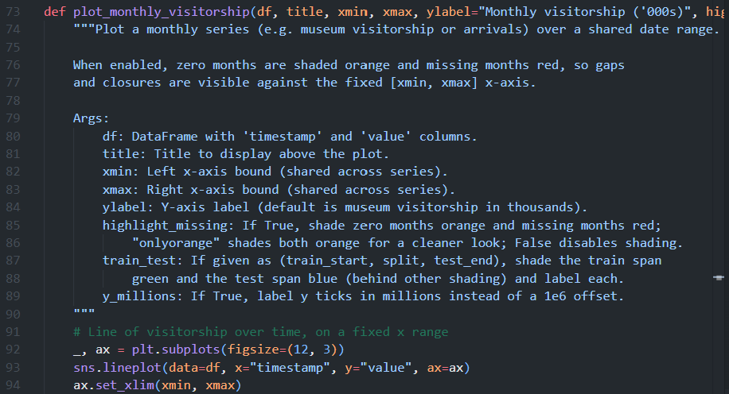
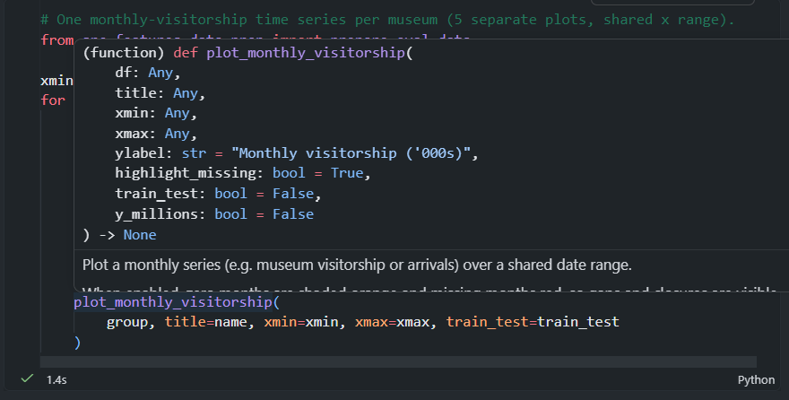
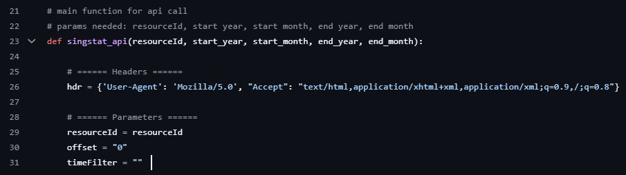

# Session 6: Team Workflow Standards and MLOps


<br>


## Activity 1: Conventional Commits, Branching and Linking Commits to GitLab

> Repo: `minions-visitorship`

#### Conventional Commits

> **Why follow a standard for commit messages?**
> - A commit message is a note to your future self and your teammates explaining what changed and why. When you're debugging a problem weeks later or onboarding someone new to the project, a well-written commit history is invaluable.
> - Following a standard structure makes the repo's commit history easier to parse by the whole team, and makes it easier to understand what each commit changed without having to read all the actual code changes.

Convention for writing commit messages (See [Conventional Commit Messages](https://www.conventionalcommits.org/en/v1.0.0/)):

```
<type>(<optional scope>): <description>
empty line as separator
<optional body>
empty line as separator
<optional footer>
```

For example, if you are committing the addition of a new model to a ML pipeline:

- **Minimally include the commit type and a short description**
    ```
    feat: add GBT Classifier to ML pipeline
    ```

- **Most descriptive (summary + body + footer)**
    ```
    feat(pipeline): add GBT Classifier to ML pipeline

    Added Gradient Boosted Trees (GBT) Classifier as an additional model
    in the training pipeline. The model is trained with default
    hyperparameters as a baseline and evaluated alongside existing models
    using the same train-test split and metrics.

    Closes #42
    ```

<hr>

**Industry-standard Commit Types**

| Type | Use for |
| --- | --- |
| `feat` | Adding, modifying or removing a feature or analysis<br>E.g. `feat(auth): add password reset function` |
| `fix` | Bug fix<br>E.g. `fix(api): correct NA handling in cleaning script` |
| `refactor` | Restructure code without changing behaviour<br>E.g. `refactor: rewrite function to be more concise` |
| `style` | Code style changes without changing behaviour<br>E.g. `style: run prettier` |
| `chore` | Cleanup, renaming, formatting of folder structure. Maintenance tasks not affecting source or tests<br>E.g. `chore: rearrange files` |
| `docs` | Changes to documentation or README<br>E.g. `docs: update README` |

**Data-oriented Commit Types**

| Type | Use for |
| --- | --- |
| `data` | Adding, updating or removing data sources or raw files<br>E.g. `data: add 2025 vouch ticketing data` |
| `analysis` | Exploratory or ad-hoc analysis<br>E.g. `analysis: explore invalid order rows with non-NA Refunded At, Refunded Amount, Cancelled At` |
| `model` | Changes to model architecture, hyperparameters or evaluation<br>E.g. `model: add GBT Classifier pipeline` |
| `pipeline` | Changes to data pipeline or workflow steps<br>E.g. `pipeline: add feature engineering step before model training` |

We don't have to stick to the above commit types strictly. We can come up with our own ones as a team.

<hr>

**Commit often**
- At the end of every session, you should have committed any changes you made to a feature branch
- You should be committing often in general

**Atomic Commits**
- When possible, a commit should encompass a single feature, change, or fix, i.e. each commit should do **one thing** and leave the codebase in a working state
- This makes it much easier to undo or rollback **specific changes** later on. It also makes your code or project easier to review.
- E.g. If you make small edits, e.g. to global variables to run a specific analysis on a certain scope, you can commit just that change. In the future, if you were required to return to that specific analysis, you can revert just that **one commit** and not affect anything else

<hr>

#### Conventional Branching

Name your branches with a prefix that says what kind of work is on it:

- `main`: The main development branch
- `feature/` (or `feat/`): For new features (e.g. `feature/add-login-page`)
- `fix/`: For bug fixes (e.g. `fix/header-bug`)
- `hotfix/`: For urgent fixes (e.g. `hotfix/security-patch`)
- `release/`: For branches preparing a release (e.g. `release/v1.2.0`)
- `chore/`: For non-code tasks like dependency, docs updates (e.g. `chore/update-dependencies`)

See [Conventional Branch](https://conventionalbranch.org/) for more information

<hr>

#### Linking Commits to GitLab

GitLab **issues** are used to track tasks and bugs. Each issue gets a number, e.g. `#12`.

- Write `Refs #12` in the footer of a commit message to link the commit to issue `#12`. The commit then shows up on the issue's page on GitLab
- Write `Closes #12` (or `Fixes #12`) in a commit message or a merge request's description, and GitLab automatically closes issue `#12` when it is merged into `main`
- Similarly, `!5` refers to merge request number 5

<hr>

#### a. Create an issue on GitLab
- Go to the `minions-visitorship` repo on GitLab → `Issues` → `New issue`
- Title: `Add participant <N> to the team list`
- Assign it to yourself, then click `Create issue`
- Note down the issue number e.g. `#12`. We will refer to it as `#<issue>` below

#### b. Create a branch following the branch naming convention
- Run `git switch main`
- Run `git pull`
- Run `git switch -c chore/<issue>-add-p<N>-to-team main` e.g. `chore/12-add-p1-to-team`
  - `chore/`, as adding to the team list is a non-code task
  - Including the issue number in the branch name makes it easy to tell which issue the branch is for

#### c. Make your change
- Create a new file `session6_lab/team/p<N>.md`, and write your name and role in it
  - Each of you creates your own file, so there will be no merge conflicts

#### d. Write a multi-line commit message following the convention
- Run `git add session6_lab/team/p<N>.md`
- Run `git commit` to open nano, and write your commit message following the convention, e.g.:
    ```
    docs(team): add participant <N> to the team list

    Added a file for participant <N> to the team folder,
    with my name and role.

    Refs #<issue>
    ```
- Save and exit nano (`Ctrl + X`, `Y`, `Enter`)
- Run `git log -n 1` to check your full commit message

#### e. Push your branch, and check the issue
- Run `git push -u origin chore/<issue>-add-p<N>-to-team`
- Open your issue on GitLab
  - Your commit now shows up on the issue's page, as your commit message has `Refs #<issue>`

#### f. Open a merge request that closes the issue
- Open a merge request from your branch into `main`
- Title: follow the commit convention e.g. `docs(team): add participant <N> to the team list`
- Description: write `Closes #<issue>`
- Click `Create merge request`

#### g. Merge it, and check the issue
- Tick `Delete source branch`, then click `Merge`
- Open your issue on GitLab. It has been closed automatically
- Run `git switch main`, then `git pull`

<br>


## Activity 2: Organisation of Project Repository and Best Practices

#### File Naming Conventions

- Use lowercase alphanumeric characters only for filenames. Don't use special characters
- Use underscores (`_`) as separators, as spaces can cause issues in the terminal
- Be descriptive but concise. The name should convey what the file does without being a long sentence

<hr>

#### Package and Module Names (Python)

- Python **modules** (`.py` files) should have short, all-lowercase names. Underscores can be used in the module name if it improves readability
- Python **packages** (folders of modules) should also have short, all-lowercase names, although the use of underscores is discouraged by [PEP 8](https://peps.python.org/pep-0008/#package-and-module-names)

```
my_project/
│
├── datautils/          ← package (folder, no underscores preferred)
│   ├── __init__.py
│   ├── clean_data.py   ← module (file, underscores fine)
│   └── load_data.py    ← module
...
```

<hr>

#### Folders

Organise files by function, e.g.:

- `data/`: raw and processed data files
- `notebooks/`: Jupyter notebooks for exploration and analysis
- `models/`: ML models
- `src/`: reusable Python scripts and modules
- `outputs/`: charts, tables, and other generated outputs
- `utils/`: utility package with utility functions

```
example-data-project/
├── data/
│   ├── raw/
│   └── processed/
├── datautils/
│   ├── __init__.py
│   ├── clean_data.py
│   └── load_data.py
├── notebooks/
│   └── eda.ipynb
├── src/
│   ├── main.py
│   ├── <>.py
│   └── <>.py
├── models/
└── outputs/
```

<br>

## Activity 3: Documentation

### Comments

> - Comments explain **why** the code does something. The code itself already shows **what** it does
> - Good comments explain things that aren't obvious from the code, e.g. assumptions, business rules, or workarounds:
>     ```python
>     # Exclude 2020, as all museums were closed for most of the year due to COVID
>     visits = visits[visits["year"] != 2020]
>     ```
> - Avoid:
>     - Comments that just repeat the code e.g. `# filter the year` above the line above
>     - Commented-out old code. Delete it instead, as Git keeps it in the commit history
>     - Outdated comments. When you change the code, update its comments too

### Docstrings

> - Docstrings are string literals that appear as the first statement in a module, function, class, or method, and serve as **inline documentation** that explains what a piece of code does, what it expects, and what it returns.
> - They can be accessed at runtime via the `.__doc__` attribute or the `help()` function
> - They can also power IDE tooltips (not analytics@gov unfortunately) and tools like Sphinx or `mkdocs` that can auto-generate documentation sites from your codebase

#### 1. Google style
- Most readable at a glance, and is widely used in data and ML teams

    

- In an IDE, hovering over the function shows its docstring as a tooltip:

    

#### 2. NumPy style
- Used in scientific Python libraries like NumPy, pandas, and scikit-learn
- More verbose and structured

    ```python
    def load_data(filepath: str, delimiter: str = ",") -> pd.DataFrame:
        """
        Load a CSV file into a DataFrame.

        Parameters
        ----------
        filepath : str
            Path to the CSV file.
        delimiter : str, optional
            Column delimiter. Defaults to comma.

        Returns
        -------
        pd.DataFrame
            A pandas DataFrame containing the loaded data.

        Raises
        ------
        FileNotFoundError
            If the filepath does not exist.
        """
    ```

#### Bad example
- This isn't a docstring, but a comment that just restates the same parameters readable from the function's signature, without adding any value

    

### README

> - `README.md` is the first thing people see on your repo's page on GitLab. It explains the project to your teammates, and to yourself in a few months' time
> - A good README covers:
>     - **What** the project is, in one or two lines
>     - **How to set it up**, e.g. creating a virtual environment and running `pip install -r requirements.txt`
>     - **How to run it**
>     - **Project structure**: what is in each folder
>     - **Data**: where it comes from, and where to put it if it is gitignored
>     - **Configuration**: settings and `.env` variables needed (never the actual secrets)
>     - **Outputs**: what the project produces, and where
>     - **Contact**: who owns or maintains the project
> - Update the README in the same merge request as the changes it describes
> - READMEs are written in Markdown. See [The Markdown Guide](https://www.markdownguide.org) and [GitHub's guide on READMEs](https://docs.github.com/en/repositories/managing-your-repositorys-settings-and-features/customizing-your-repository/about-readmes)

<br>


## Activity 4: Ensuring Reproducibility

#### Writing `requirements.txt`

> - A `requirements.txt` file lists all the packages (and optionally their exact versions) that your project depends on.
> - Anyone cloning your repo can use it to recreate the exact same environment by running `pip install -r requirements.txt` in their terminal. This ensures the code runs the same way on their machine as it does on yours.
>     - The `-r` flag tells pip to read the file for packages, instead of trying to install a package called "requirements.txt"

Example `requirements.txt`:

```python
# Minimally list the packages needed (don't just do this)
# It refers to the latest available versions
pandas
numpy
matplotlib
seaborn

# Best to include the specific versions for reproducibility
pandas==2.3.3
numpy==2.3.4
matplotlib==3.10.7
seaborn==0.13.2
```

<hr>

**Ways to generate a `requirements.txt`**

1. **Using the `pipreqs` module** <span style="color:salmon">(currently not working on analytics@gov)</span>
    - `pip install pipreqs`
    - `pipreqs .` scans all `.py` files in your current directory, and creates a `requirements.txt` that only includes explicitly imported packages
        - `--savepath <file>` to specify a file path to save to (default `requirements.txt`)
        - `--clean <file>` on an existing `requirements.txt` to remove libraries not actually being used in the current project
    - On analytics@gov, it has to use the ship-nexus PyPI proxy:
        ```bash
        pipreqs . --pypi-server https://ship-nexus.analytics.gov.sg/repository/pypi-proxy/simple/
        ```

2. **LLM-driven approach**
    - Step 1: Navigate to your project directory in your terminal, and run this command to list all the import statements in all `.py` files:
        ```bash
        grep -rh "^import\|^from" --include="*.py" . | sort -u
        ```
    - Step 2: Copy the output, and paste this prompt into Pair or other LLMs:
        > Below is a list of import statements in my python project, use them to generate a list of terminal commands each in the form of `pip index versions <package> --index-url https://ship-nexus.analytics.gov.sg/repository/pypi-proxy/simple/` which I can immediately copy and paste in my terminal to find the specific package versions. Only include the ones for the packages that are not already packaged with Python
        >
        > **<Replace with output from step 1>**
    - Step 3: Run the generated commands, copy their output, and paste this prompt into Pair or other LLMs:
        > Here is the output from the previous step. Use it to generate the content for me to copy and paste into my requirements.txt
        >
        > **<Replace with output from step 2>**
    - Step 4: Copy the output into your `requirements.txt`. It should look like the example above, with a specific version for each package

3. **Using `pip freeze > requirements.txt`**
    - Captures every package and exact version currently installed in your environment, including packages not used by the project
    - It will also be exceedingly verbose as it includes dependencies, which is unnecessary as pip installing a package automatically installs all its dependencies

4. **Manually writing out `requirements.txt`**
    - If all else fails, I recommend manually writing out `requirements.txt`
    - Remember to list out the packages and their specific version numbers

<hr>

To install these packages without affecting other projects on your machine, install them into a **virtual environment**, which we will create using `venv` in Activity 5 and `uv` in Activity 6.

<br>


## Activity 5: Using Virtual Environments using `venv`

> Repo: `minions-visitorship`
> Branch: `venv-p<N>`
>
> - If you don't use a virtual environment, every project on your machine shares the same installed packages e.g. analytics@gov provides `numpy==2.3.4`. If you then run a project written for a much older version e.g. the museum forecasting repo uses `numpy==1.26.4`, the code may break, as functions may have been added, removed, or changed between versions
> - A virtual environment is an isolated Python environment for one project, with its own packages and versions, independent of everything else on your machine
> - Each user (repo creator / collaborators) creates their own virtual environment. <span style="color:salmon">A virtual environment should never be committed to Git</span>, as it is very large and specific to each user's machine

First, create a branch for this activity:
- Run `cd ~/minions-visitorship`
- Run `git switch main`, then `git pull`
- Run `git switch -c venv-p<N> main`

#### a. If you are using a Mac/Linux terminal (e.g. bash, zsh) <span style="color:cyan">(Analytics@gov uses bash)</span>
- Run `which python` to see which Python you are currently using
  - It is the Python installed for your whole machine, not just this project
- Create the virtual environment:
    ```
    python -m venv .venv
    ```
  - The `-m` flag tells Python to run a module as a script. `venv` is the built-in Python module for creating virtual environments
  - `.venv` is the name of the folder containing the virtual environment (it is standard convention to use `.venv`)

<hr>

- Run `git status`
  - On older versions of Python, `.venv/` shows up under `Untracked files`. On Python 3.13 and newer, it doesn't, as `venv` automatically adds its own `.gitignore` inside the folder
- Either way, add it to your repo's `.gitignore`, so it is ignored for everyone on any Python version:
  - Open `.gitignore` at the root of the repo, and add the line `.venv/`
  - Run `git status`. Only `.gitignore` is modified
  - Run `git add .gitignore`
  - Run `git commit -m "chore: ignore .venv folder"`

<hr>

- Activate the virtual environment:
    ```
    source .venv/bin/activate
    ```
  - You know the virtual environment is active if you see `(.venv)` at the start of your terminal line
  - You activate once at the start of each working session, and deactivate when you're done
- Run `which python` again
  - It now points inside your project e.g. `/home/jovyan/minions-visitorship/.venv/bin/python`
- Install the project's packages into the virtual environment:
    ```
    pip install -r session6_lab/requirements.txt
    ```
- Run `pip list`
  - Check that the versions of `pandas`, `numpy`, `matplotlib`, `seaborn` and `python-dotenv` match `session6_lab/requirements.txt`
- Deactivate the virtual environment when you are done:
    ```
    deactivate
    ```
  - `(.venv)` disappears from your terminal line
  - Run `which python`. You are back on your machine's Python

#### b. If you are using a Windows terminal (e.g. Windows Powershell)
The steps are the same as part a, except for these commands:

| Step | Mac/Linux | Windows (PowerShell) |
| --- | --- | --- |
| Check which Python you are using | `which python` | `where.exe python` |
| Activate | `source .venv/bin/activate` | `.venv\Scripts\activate` |

- Use `where.exe`, not `where`. In PowerShell, `where` means something else
- If activating fails with `running scripts is disabled on this system`, run this once, then activate again:
    ```
    Set-ExecutionPolicy -Scope Process -ExecutionPolicy RemoteSigned
    ```

<br>


## Activity 6: Using Virtual Environments using `uv`

> Repo: `minions-visitorship`
> Branch: `uv-p<N>`
>
> - `uv` is a much faster alternative to `pip` and `venv`, and can also manage which **Python version** a project uses
> - Use it when a project requires a specific version of Python. Teammates running the project on their personal laptops will then all use the same Python version
> - Note: On analytics@gov, you cannot install other versions of Python, so a project should use the version analytics@gov already has

First, create a branch for this activity from your `venv-p<N>` branch, so it already ignores `.venv/`:
- If `(.venv)` is still at the start of your terminal line, run `deactivate`
- Run `git switch venv-p<N>`
- Run `git switch -c uv-p<N> venv-p<N>`

#### a. If you are using a Mac/Linux terminal (e.g. bash, zsh) <span style="color:cyan">(Analytics@gov uses bash)</span>
- Install `uv`:
    ```
    pip install uv
    ```
- Run `uv --version` to check it is installed

<hr>

**Standardise the Python version**
- Run `python --version`, e.g. `Python 3.12.3`
- Pin the project to that version (major.minor only), e.g.:
    ```
    uv python pin 3.12
    ```
  - You should see ``Pinned `.python-version` to `3.12` ``
  - This creates a `.python-version` file. Whenever anyone creates a virtual environment for this project with `uv`, it uses this Python version. On a personal laptop, `uv` even downloads that version if it is not installed yet
- Commit the file, so everyone gets the same version:
  - Run `git add .python-version`
  - Run `git commit -m "chore: pin python version"`

<hr>

**Create and use the virtual environment**
- Create a new virtual environment, replacing the one from Activity 5:
    ```
    uv venv --clear .venv
    ```
  - `--clear` is needed, as `.venv` already exists from Activity 5. Without it, you get `A virtual environment already exists at: .venv`
  - It uses the Python version in `.python-version`. You can also choose a version directly, e.g. `uv venv --python 3.12 .venv`
- Activate it the same way as in Activity 5: `source .venv/bin/activate`
- Install the project's packages:
    ```
    uv pip install -r session6_lab/requirements.txt
    ```
  - Note the use of `uv pip` instead of `pip`, as `uv` provides its own `pip`. A plain `pip` would install into a different environment
- Run `uv pip list` to check the installed packages
- Run `deactivate` when you are done

#### b. If you are using a Windows terminal (e.g. Windows Powershell)
- The steps are the same as part a, except you activate with `.venv\Scripts\activate` (see Activity 5, part b)
- Every `uv` command (`uv python pin`, `uv venv`, `uv pip install`, `uv pip list`) is the same on Windows

<br>


## Activity 7: MLOps

> **MLOps** (Machine Learning Operations) is a set of practices for taking an ML model from a notebook experiment to something that runs reliably in production, and keeping it working afterwards. It is like DevOps for ML, except you have to manage **code, data and models**, not just code.
>
> It is not one tool, but a list of practices that a team adopts step by step.

| Practice | What it means |
| --- | --- |
| Version control | Version the code, data and models, so any result can be traced and reproduced |
| Reproducible environments | Make sure the code runs the same way on any machine |
| Experiment tracking | Record each training run's settings and results |
| Automated pipelines | Run data prep → training → evaluation as code, end to end |
| CI/CD | Automatically test, then release, changes to code and models |
| Model registry | A central record of trained models, and which one is in production |
| Monitoring | Watch the model's performance in production, and detect when it gets worse |

<hr>

#### 1. Version control
Every result should be traceable to the exact code, data and model that produced it. Git handles code well, but data and models are usually too large for Git, so they need to be versioned separately.

**How to implement it in an ML project:**
- Keep all code in Git, including notebooks and scripts, not just files on your machine
- Gitignore large data files and trained models (Session 1), and store them in a shared location instead
- Version your data snapshots e.g. `visits_2025-06.csv`, or use a tool like DVC, which tracks data versions alongside your Git commits
- Record which commit and data version produced each model e.g. in the model's filename or a metadata file
- Tag the commit used for each production model e.g. `git tag v1.0`

<hr>

#### 2. Reproducible environments
The same code can give different results, or break, with different package or Python versions.

**How to implement it in an ML project:**
- Pin package versions in `requirements.txt` (Activity 4)
- Use a virtual environment for each project (Activity 5)
- Pin the Python version with `.python-version` (Activity 6)
- Fix random seeds e.g. `random_state=42` in scikit-learn, so training gives the same results each time
- Document the setup steps in the README (Activity 3)

<hr>

#### 3. Experiment tracking
While developing a model, you will train many versions with different features, hyperparameters and data. Without a record, you can't tell which run produced which result, or reproduce your best model.

**How to implement it in an ML project:**
- For every training run, record:
    - the parameters (e.g. features used, hyperparameters)
    - the metrics (e.g. RMSE, accuracy)
    - the data version, the Git commit hash, and where the model file was saved
- The simplest way is to add one row per run to a results CSV
- A tool like MLflow does this with `mlflow.log_param()` and `mlflow.log_metric()`, and gives you a UI to compare runs

<hr>

#### 4. Automated pipelines
Running notebook cells by hand only works if you remember every step, in the right order. A pipeline turns the whole path from raw data to trained model into code you can rerun with one command.

**How to implement it in an ML project:**
- Move each step from notebooks into functions in `.py` modules e.g. `load.py`, `clean.py`, `features.py`, `train.py`, `evaluate.py`
- Have one script e.g. `main.py` that runs the steps in order
- Keep settings (e.g. dates, file paths, hyperparameters) in a config file, not hard-coded in the code
- Use notebooks for exploration only, and import the functions from your modules

<hr>

#### 5. CI/CD
- **Continuous Integration (CI)**: automatically run checks, such as tests, on every push or merge request
- **Continuous Delivery / Deployment (CD)**: automatically release changes that pass the checks

This catches broken code before it reaches `main`, instead of after.

**How to implement it in an ML project:**
- Write tests for your key functions e.g. using `pytest` to check that the cleaning step removes invalid rows
- Add a `.gitlab-ci.yml` file to the repo, which tells GitLab to run your tests on every merge request. GitLab can block merging if the tests fail
- At a later stage, automatically retrain and evaluate the model, and only release it if it performs better than the current one

<hr>

#### 6. Model registry
A central place that stores your trained models, with each model's version, metrics, the code and data used to train it, and its stage (e.g. testing or production). It answers "which model is live, and how was it built?"

**How to implement it in an ML project:**
- Save each trained model with a version number e.g. `model_v3.joblib`, along with a metadata file (date, Git commit hash, data version, metrics)
- Store models in a shared location, not in Git
- A tool like MLflow's Model Registry does this, and lets you mark which version is in production
- Only promote a model to production after it has been evaluated and reviewed

<hr>

#### 7. Monitoring
A model is trained on past data, but real-world data changes over time e.g. visitor patterns change after a new exhibition opens. This is called **drift**, and it can make the model's predictions quietly get worse.

**How to implement it in an ML project:**
- Save the model's predictions, and compare them with the actual values once they are known, to track the error over time
- Compare new input data with the training data e.g. averages, ranges, missing values, and flag when they differ a lot
- Set a threshold for when the model should be retrained
- Check the data quality before making predictions

<br>


## Final Exam: Application of all previously taught Git concepts throughout the workshop

> Repo: `minions-visitorship`
> Branch: `final-main` (consider this the "main" branch for the project)

In this final exam, the 3 of you will build a project together from scratch, applying everything we have learnt throughout the workshop.

- For the sake of time, all the content and code you need is provided below. The point of this exam is purely on the Git concepts, not the code itself
- Each step only tells you **what** needs to be done, but **not** the Git or terminal commands to do it. Refer back to the reference tables and activities from Sessions 1 to 6 when you get stuck
- I will be guiding you throughout, but without handholding

#### The project
A simplified version of a museum visitorship forecasting project, except the visitors are all minions.

- It forecasts monthly visitorship for 5 NHB museums: ACM, IHC, MHC, NMS and TPM
- It trains a baseline (the historical monthly average) and 6 models for each museum: SARIMAX, Holt-Winters, SVR, Random Forest, XGBoost and LSTM
- Every function only **prints** what it would do, as the code is not the point here

`final-main` currently only contains a `README.md` with the project's title. By the end of the exam, the repo will look like this:

```
(repo root)
├── README.md
├── requirements.txt
├── .gitignore
├── .env                 ← gitignored
├── config.py
├── main.py
├── src/
│   ├── __init__.py
│   ├── fetch_singstat.py
│   ├── clean_data.py
│   ├── split.py
│   ├── features.py
│   ├── evaluate.py
│   ├── tune.py
│   ├── plots.py
│   ├── report.py
│   ├── save_models.py
│   └── forecast.py
├── models/
│   ├── __init__.py
│   ├── baseline.py
│   ├── sarimax.py
│   ├── holt_winters.py
│   ├── svr.py
│   ├── rf.py
│   ├── xgboost_model.py
│   └── lstm.py
└── outputs/             ← gitignored (plots, report, saved models)
```

#### How each task works
Unless told otherwise, follow the standard workflow for every task:

1. Create an issue for your task on GitLab, using the title and description provided
2. Create a branch off the latest `final-main`, named following the branch naming convention, and including your issue number
3. Make your changes, committing as you go. Keep your commits atomic, and write multi-line commit messages following the commit convention, referencing your issue
4. Push your branch, and open a merge request into `final-main` that closes your issue
5. Set your reviewer as both the Reviewer and Assignee of your merge request
6. **As a reviewer:** check the code, the commit messages and the merge request, run the code where possible, then approve and merge it. There is no need to delete branches

#### Rules
- The exam is split into phases. Each phase has tasks for each participant. Wait for my signal before starting the next phase
- Each phase ends with step-by-step instructions on who merges which merge request, and in what order
- Before your merge request is merged, make sure your branch has the latest `final-main` merged into it, and resolve any merge conflicts
- At the end of each phase, everyone gets the latest `final-main` and runs the pipeline. The expected output is provided
- Some phases include bugs. The phase will tell you who notices the bug and opens an issue for it, who fixes it, and provides the fix to copy

<hr>

## Phase 1: Project Setup

### <u>Participant 1</u>

#### 1. Create an issue
- Title: `Set up pipeline skeleton with baseline model`
- Description: `Create config.py, main.py and the baseline model (historical monthly average), so the pipeline trains the baseline for ACM, IHC and MHC.`

#### 2. Start writing the config
- Get the latest `final-main`, and start working straight away by creating `config.py`:
    ```python
    """Settings for the minions visitorship forecasting pipeline."""

    # Museums to forecast visitorship for
    MUSEUMS = ["ACM", "IHC", "MHC"]

    # Models to train for each museum
    MODELS = ["baseline"]

    # Features used by the models
    FEATURES = []
    ```

#### 3. Oops, you are still on `final-main`
- You realise you haven't created a branch yet. Move your uncommitted work onto a new branch for your issue, without losing it
- Commit `config.py`

#### 4. Add the baseline model
- Create an empty `models/__init__.py`
- Create `models/baseline.py`:
    ```python
    """Baseline model: the historical monthly average."""
    import time


    def train_baseline(museum):
        """Train the baseline model for one museum.

        The baseline predicts each month's visitorship as the average visitorship
        for that month in previous years. Every other model must beat it to be useful.

        Args:
            museum (str): The museum's code, e.g. "ACM".
        """
        print(f"Training baseline (historical monthly average) for {museum}")
        time.sleep(0.2)  # Pretend to take time, like real training would
    ```
- Commit your changes

#### 5. Add the pipeline
- Create `main.py`:
    ```python
    """Run the minions visitorship forecasting pipeline."""
    from config import MODELS, MUSEUMS
    from models.baseline import train_baseline
    from src.clean_data import clean_visitorship
    from src.fetch_singstat import fetch_visitorship
    from src.split import split_train_test


    def main():
        """Fetch, clean and split each museum's data, then train every model on it."""
        for museum in MUSEUMS:
            print(f"\n===== {museum} =====")
            fetch_visitorship(museum)
            clean_visitorship(museum)
            split_train_test(museum)

            for model in MODELS:
                # Each model has its own training function in the models/ folder
                if model == "baseline":
                    train_baseline(museum)


    if __name__ == "__main__":
        main()
    ```
    - Note: `main.py` uses code from Participants 2 and 3, so it will only run once their merge requests have been merged
- Commit your changes

#### 6. Document the pipeline
- Add this section to `README.md`:
    ````
    ## Pipeline

    For each museum in `config.py`, `main.py`:

    1. Fetches the monthly visitorship data from SingStat
    2. Cleans the data
    3. Splits it into training and test sets
    4. Trains each model in `MODELS`

    Run it from the repo root with `python main.py`
    ````
- Commit your changes

#### 7. Open your merge request
- Push your branch, and open a merge request into `final-main` that closes your issue
- Your reviewer and assignee is Participant 2

### <u>Participant 2</u>

#### 1. Create an issue
- Title: `Add requirements, .gitignore, and data cleaning and splitting`
- Description: `Add requirements.txt and .gitignore, and the functions to clean the data and split it into training and test sets.`

#### 2. Start writing the requirements
- Get the latest `final-main`, and start working straight away by creating `requirements.txt`:
    ```
    pandas==2.3.3
    numpy==2.3.4
    matplotlib==3.10.7
    seaborn==0.13.2
    python-dotenv==1.2.4
    ```

#### 3. Oops, you are still on `final-main`
- You realise you haven't created a branch yet. Move your uncommitted work onto a new branch for your issue, without losing it
- Commit `requirements.txt`

#### 4. Ignore files that should never be committed
- Create `.gitignore`:
    ```
    # Virtual environment
    .venv/

    # Python cache
    __pycache__/

    # Pipeline outputs (plots, reports and saved models)
    outputs/
    ```
- Commit your changes

#### 5. Add data cleaning and splitting
- Create an empty `src/__init__.py`
- Create `src/clean_data.py`:
    ```python
    """Clean the raw visitorship data."""
    import time


    def clean_visitorship(museum):
        """Clean one museum's monthly visitorship data.

        Args:
            museum (str): The museum's code, e.g. "ACM".
        """
        # Months when a museum was closed have zero visitors, and would mislead the models
        print(f"Cleaning {museum} data: removing missing months and closures")
        time.sleep(0.2)  # Pretend to take time, like real cleaning would
    ```
- Create `src/split.py`:
    ```python
    """Split the data into training and test sets."""
    import time


    def split_train_test(museum):
        """Split one museum's data into a training set and a test set by date.

        Time series must be split by date, not randomly, so the models are always
        tested on months that come after the months they were trained on.

        Args:
            museum (str): The museum's code, e.g. "ACM".
        """
        print(f"Splitting {museum} data: train on Jan 2014 to Mar 2024, test on Apr 2024 to Mar 2026")
        time.sleep(0.2)  # Pretend to take time, like real splitting would
    ```
- Commit your changes. Keep them atomic: one commit for cleaning, and one for splitting

#### 6. Document the setup
- Add this section to `README.md`:
    ```
    ## Setup

    1. Create and activate a virtual environment
    2. Install the packages in `requirements.txt`
    3. Create a `.env` file with your SingStat API key (see Data)
    ```
- Commit your changes

#### 7. Open your merge request
- Push your branch, and open a merge request into `final-main` that closes your issue
- Your reviewer and assignee is Participant 3

### <u>Participant 3</u>

#### 1. Create an issue
- Title: `Fetch visitorship data from the SingStat API`
- Description: `Fetch each museum's monthly visitorship data from the SingStat API, reading the API key from a .env file that is never committed.`

#### 2. Start writing the API call
- Get the latest `final-main`, and start working straight away by creating an empty `src/__init__.py`, and `src/fetch_singstat.py`:
    ```python
    """Fetch monthly museum visitorship data from the SingStat API."""
    import os
    import time

    from dotenv import load_dotenv

    # Read the API key from the .env file, so it is never written in the code
    load_dotenv()
    API_KEY = os.getenv("SINGSTAT_API_KEY")


    def fetch_visitorship(museum):
        """Fetch one museum's monthly visitorship data from SingStat.

        Args:
            museum (str): The museum's code, e.g. "ACM".
        """
        if API_KEY is None:
            print("Error: SINGSTAT_API_KEY not found. Add it to your .env file")
            return
        print(f"Fetching {museum} monthly visitorship from SingStat")
        time.sleep(0.2)  # Pretend to take time, like a real API call would
    ```

#### 3. Oops, you are still on `final-main`
- You realise you haven't created a branch yet. Move your uncommitted work onto a new branch for your issue, without losing it
- Commit your changes

#### 4. Store the API key safely
- Create a `.env` file at the repo root, with the API key:
    ```
    SINGSTAT_API_KEY=minions-singstat-7f3a9c
    ```
- <span style="color:salmon">`.env` must never be committed.</span> Create `.gitignore` so that Git ignores it:
    ```
    # Secrets e.g. API keys
    .env
    ```
- Check that `.env` no longer shows up as an untracked file, then commit `.gitignore` only

#### 5. Document the data source
- Add this section to `README.md`:
    ````
    ## Data

    Monthly visitorship for each museum is fetched from the SingStat API in `src/fetch_singstat.py`.

    The API key is read from a `.env` file, which is gitignored and must never be committed:

    ```
    SINGSTAT_API_KEY=<your key>
    ```
    ````
- Commit your changes

#### 6. Open your merge request
- Push your branch, and open a merge request into `final-main` that closes your issue
- Your reviewer and assignee is Participant 1

### <u>Everyone: End of Phase 1</u>

#### 1. Merge the merge requests, one at a time
Follow these steps in order. Wait for each step to be done before moving on to the next:

1. **Participant 3:** review and merge Participant 2's merge request
2. **Participant 3:** merge the latest `final-main` into your branch. You will get conflicts in 2 files. Resolve them so that:
    - `.gitignore` (Participant 2 also created one) looks like this:
    ```
    # Virtual environment
    .venv/

    # Python cache
    __pycache__/

    # Pipeline outputs (plots, reports and saved models)
    outputs/

    # Secrets e.g. API keys
    .env
    ```
    - `README.md` looks like this:
    ````
    # Minions Visitorship Forecasting

    ## Setup

    1. Create and activate a virtual environment
    2. Install the packages in `requirements.txt`
    3. Create a `.env` file with your SingStat API key (see Data)

    ## Data

    Monthly visitorship for each museum is fetched from the SingStat API in `src/fetch_singstat.py`.

    The API key is read from a `.env` file, which is gitignored and must never be committed:

    ```
    SINGSTAT_API_KEY=<your key>
    ```
    ````

    Then push your branch
3. **Participant 1:** review and merge Participant 3's merge request
4. **Participant 1:** merge the latest `final-main` into your branch. You will get a conflict in `README.md`. Resolve it so that it looks like this:
    ````
    # Minions Visitorship Forecasting

    ## Setup

    1. Create and activate a virtual environment
    2. Install the packages in `requirements.txt`
    3. Create a `.env` file with your SingStat API key (see Data)

    ## Data

    Monthly visitorship for each museum is fetched from the SingStat API in `src/fetch_singstat.py`.

    The API key is read from a `.env` file, which is gitignored and must never be committed:

    ```
    SINGSTAT_API_KEY=<your key>
    ```

    ## Pipeline

    For each museum in `config.py`, `main.py`:

    1. Fetches the monthly visitorship data from SingStat
    2. Cleans the data
    3. Splits it into training and test sets
    4. Trains each model in `MODELS`

    Run it from the repo root with `python main.py`
    ````

    Check that the pipeline now runs, then push your branch
5. **Participant 2:** review and merge Participant 1's merge request

#### 2. Run the pipeline
Once all 3 merge requests have been merged:

- Get the latest `final-main`
- Create a virtual environment, and install the packages in `requirements.txt` (Session 6, Activities 5 and 6)
- Create your own `.env` file at the repo root, with the API key:
    ```
    SINGSTAT_API_KEY=minions-singstat-7f3a9c
    ```
- Run the pipeline. You should see:
    ```

    ===== ACM =====
    Fetching ACM monthly visitorship from SingStat
    Cleaning ACM data: removing missing months and closures
    Splitting ACM data: train on Jan 2014 to Mar 2024, test on Apr 2024 to Mar 2026
    Training baseline (historical monthly average) for ACM

    ===== IHC =====
    Fetching IHC monthly visitorship from SingStat
    Cleaning IHC data: removing missing months and closures
    Splitting IHC data: train on Jan 2014 to Mar 2024, test on Apr 2024 to Mar 2026
    Training baseline (historical monthly average) for IHC

    ===== MHC =====
    Fetching MHC monthly visitorship from SingStat
    Cleaning MHC data: removing missing months and closures
    Splitting MHC data: train on Jan 2014 to Mar 2024, test on Apr 2024 to Mar 2026
    Training baseline (historical monthly average) for MHC
    ```
    - If you see `Error: SINGSTAT_API_KEY not found`, check your `.env` file

<hr>

## Phase 2: Feature Engineering

### <u>Participant 1</u>

#### 1. Create an issue
- Title: `Add lag features`
- Description: `Add lag features (visitorship 1, 2 and 12 months before) to the pipeline.`

#### 2. Start writing the feature
- Go back to your branch from Phase 1 (pretend you forgot to switch away from it after Phase 1)
- Create `src/features.py`:
    ```python
    """Create features for the forecasting models."""
    import time


    def add_lags(museum):
        """Add lag features: the visitorship 1, 2 and 12 months before each month.

        Args:
            museum (str): The museum's code, e.g. "ACM".
        """
        print(f"Adding lag features for {museum}: visitorship 1, 2 and 12 months before")
        time.sleep(0.2)  # Pretend to take time, like real feature engineering would
    ```
- Commit your changes

#### 3. Oops, wrong branch
- You realise you committed onto your branch from Phase 1, which has already been merged
- Move this commit onto a new branch for your issue, created from the latest `final-main`
- Then remove the commit from your Phase 1 branch, so it is back to how it was

#### 4. Add the feature to the config
- In `config.py`, change `FEATURES = []` to:
    ```python
    FEATURES = ["lag_1", "lag_2", "lag_12"]
    ```
- Commit your changes

#### 5. Add the feature to the pipeline
- In `main.py`, add this import with the other imports:
    ```python
    from src.features import add_lags
    ```
- Then call it right after `split_train_test(museum)`:
    ```python
            add_lags(museum)
    ```
- Commit your changes

#### 6. Document the feature
- Add this section to the end of `README.md`:
    ```
    ## Features

    - `lag_1`, `lag_2`, `lag_12`: visitorship 1, 2 and 12 months before
    ```
- Commit your changes

#### 7. Open your merge request
- Push your branch, and open a merge request into `final-main` that closes your issue
- Your reviewer and assignee is Participant 3

### <u>Participant 2</u>

#### 1. Create an issue
- Title: `Add monthly average feature`
- Description: `Add the monthly_avg feature (average visitorship for each calendar month) to the pipeline.`

#### 2. Start writing the feature
- Go back to your branch from Phase 1 (pretend you forgot to switch away from it after Phase 1)
- Create `src/features.py`:
    ```python
    """Create features for the forecasting models."""
    import time


    def add_monthly_avg(museum):
        """Add the monthly_avg feature: the average visitorship for each calendar month.

        Args:
            museum (str): The museum's code, e.g. "ACM".
        """
        print(f"Adding monthly_avg feature for {museum}: average visitorship for each calendar month")
        time.sleep(0.2)  # Pretend to take time, like real feature engineering would
    ```
- Commit your changes

#### 3. Oops, wrong branch
- You realise you committed onto your branch from Phase 1, which has already been merged
- Move this commit onto a new branch for your issue, created from the latest `final-main`
- Then remove the commit from your Phase 1 branch, so it is back to how it was

#### 4. Add the feature to the config
- In `config.py`, change `FEATURES = []` to:
    ```python
    FEATURES = ["monthly_avg"]
    ```
- Commit your changes

#### 5. Add the feature to the pipeline
- In `main.py`, add this import with the other imports:
    ```python
    from src.features import add_monthly_avg
    ```
- Then call it right after `split_train_test(museum)`:
    ```python
            add_monthly_avg(museum)
    ```
- Commit your changes

#### 6. Document the feature
- Add this section to the end of `README.md`:
    ```
    ## Features

    - `monthly_avg`: average visitorship for each calendar month
    ```
- Commit your changes

#### 7. Open your merge request
- Push your branch, and open a merge request into `final-main` that closes your issue
- Your reviewer and assignee is Participant 1

### <u>Participant 3</u>

#### 1. Create an issue
- Title: `Add sin and cos month features`
- Description: `Add the sin_month and cos_month features (the month as a repeating cycle) to the pipeline.`

#### 2. Start writing the feature
- Go back to your branch from Phase 1 (pretend you forgot to switch away from it after Phase 1)
- Create `src/features.py`:
    ```python
    """Create features for the forecasting models."""
    import time


    def add_month_cycle(museum):
        """Add the sin_month and cos_month features: the month as a repeating cycle.

        Turning the month into a cycle tells the models that December and January
        are next to each other, which a month number from 1 to 12 does not.

        Args:
            museum (str): The museum's code, e.g. "ACM".
        """
        print(f"Adding sin_month and cos_month features for {museum}: the month as a repeating cycle")
        time.sleep(0.2)  # Pretend to take time, like real feature engineering would
    ```
- Commit your changes

#### 3. Oops, wrong branch
- You realise you committed onto your branch from Phase 1, which has already been merged
- Move this commit onto a new branch for your issue, created from the latest `final-main`
- Then remove the commit from your Phase 1 branch, so it is back to how it was

#### 4. Add the feature to the config
- In `config.py`, change `FEATURES = []` to:
    ```python
    FEATURES = ["sin_month", "cos_month"]
    ```
- Commit your changes

#### 5. Add the feature to the pipeline
- In `main.py`, add this import with the other imports:
    ```python
    from src.features import add_month_cycle
    ```
- Then call it right after `split_train_test(museum)`:
    ```python
            add_month_cycle(museum)
    ```
- Commit your changes

#### 6. Document the feature
- Add this section to the end of `README.md`:
    ```
    ## Features

    - `sin_month`, `cos_month`: the month as a repeating cycle, so December and January are next to each other
    ```
- Commit your changes

#### 7. Open your merge request
- Push your branch, and open a merge request into `final-main` that closes your issue
- Your reviewer and assignee is Participant 2

### <u>Everyone: End of Phase 2</u>

#### 1. Merge the merge requests, one at a time
Follow these steps in order. Wait for each step to be done before moving on to the next:

1. **Participant 2:** review and merge Participant 3's merge request
2. **Participant 1:** merge the latest `final-main` into your branch. You will get conflicts in 4 files. Resolve them so that:
    - `src/features.py` has both functions. <span style="color:salmon">Accepting both changes will not work here</span>, as Git has mixed the two functions together. Make the file look like this:
    ```python
    """Create features for the forecasting models."""
    import time


    def add_lags(museum):
        """Add lag features: the visitorship 1, 2 and 12 months before each month.

        Args:
            museum (str): The museum's code, e.g. "ACM".
        """
        print(f"Adding lag features for {museum}: visitorship 1, 2 and 12 months before")
        time.sleep(0.2)  # Pretend to take time, like real feature engineering would


    def add_month_cycle(museum):
        """Add the sin_month and cos_month features: the month as a repeating cycle.

        Turning the month into a cycle tells the models that December and January
        are next to each other, which a month number from 1 to 12 does not.

        Args:
            museum (str): The museum's code, e.g. "ACM".
        """
        print(f"Adding sin_month and cos_month features for {museum}: the month as a repeating cycle")
        time.sleep(0.2)  # Pretend to take time, like real feature engineering would
    ```
    - In `config.py`, replace the whole conflict, including the markers (`<<<<<<<`, `=======`, `>>>>>>>`), with this one line:
    ```python
    FEATURES = ["lag_1", "lag_2", "lag_12", "sin_month", "cos_month"]
    ```
    - `main.py` has one combined import, and both calls, in this order:
    ```python
    from src.features import add_lags, add_month_cycle
    ```
    ```python
            add_lags(museum)
            add_month_cycle(museum)
    ```
    - `README.md` ends with one `## Features` section, like this:
    ```
    ## Features

    - `lag_1`, `lag_2`, `lag_12`: visitorship 1, 2 and 12 months before
    - `sin_month`, `cos_month`: the month as a repeating cycle, so December and January are next to each other
    ```

    Check that the pipeline runs, then push your branch
3. **Participant 3:** review and merge Participant 1's merge request
4. **Participant 2:** merge the latest `final-main` into your branch. You will get conflicts in the same 4 files. Resolve them so that:
    - `src/features.py` looks like this:
    ```python
    """Create features for the forecasting models."""
    import time


    def add_lags(museum):
        """Add lag features: the visitorship 1, 2 and 12 months before each month.

        Args:
            museum (str): The museum's code, e.g. "ACM".
        """
        print(f"Adding lag features for {museum}: visitorship 1, 2 and 12 months before")
        time.sleep(0.2)  # Pretend to take time, like real feature engineering would


    def add_monthly_avg(museum):
        """Add the monthly_avg feature: the average visitorship for each calendar month.

        Args:
            museum (str): The museum's code, e.g. "ACM".
        """
        print(f"Adding monthly_avg feature for {museum}: average visitorship for each calendar month")
        time.sleep(0.2)  # Pretend to take time, like real feature engineering would


    def add_month_cycle(museum):
        """Add the sin_month and cos_month features: the month as a repeating cycle.

        Turning the month into a cycle tells the models that December and January
        are next to each other, which a month number from 1 to 12 does not.

        Args:
            museum (str): The museum's code, e.g. "ACM".
        """
        print(f"Adding sin_month and cos_month features for {museum}: the month as a repeating cycle")
        time.sleep(0.2)  # Pretend to take time, like real feature engineering would
    ```
    - In `config.py`, replace the whole conflict, including the markers (`<<<<<<<`, `=======`, `>>>>>>>`), with this one line:
    ```python
    FEATURES = ["lag_1", "lag_2", "lag_12", "monthly_avg", "sin_month", "cos_month"]
    ```
    - `main.py` has one combined import, and all 3 calls, in this order:
    ```python
    from src.features import add_lags, add_month_cycle, add_monthly_avg
    ```
    ```python
            add_lags(museum)
            add_monthly_avg(museum)
            add_month_cycle(museum)
    ```
    - `README.md` ends with one `## Features` section, like this:
    ```
    ## Features

    - `lag_1`, `lag_2`, `lag_12`: visitorship 1, 2 and 12 months before
    - `monthly_avg`: average visitorship for each calendar month
    - `sin_month`, `cos_month`: the month as a repeating cycle, so December and January are next to each other
    ```

    Check that the pipeline runs, then push your branch
5. **Participant 1:** review and merge Participant 2's merge request

#### 2. Run the pipeline
Once all 3 merge requests have been merged:

- Get the latest `final-main`
- Run the pipeline. For each museum, you should now also see the 3 feature steps:
    ```

    ===== ACM =====
    Fetching ACM monthly visitorship from SingStat
    Cleaning ACM data: removing missing months and closures
    Splitting ACM data: train on Jan 2014 to Mar 2024, test on Apr 2024 to Mar 2026
    Adding lag features for ACM: visitorship 1, 2 and 12 months before
    Adding monthly_avg feature for ACM: average visitorship for each calendar month
    Adding sin_month and cos_month features for ACM: the month as a repeating cycle
    Training baseline (historical monthly average) for ACM

    ===== IHC =====
    ...
    ```

<hr>

## Phase 3: Models

### <u>Participant 1</u>

#### 1. Create an issue
- Title: `Add SARIMAX and Holt-Winters models`
- Description: `Add the SARIMAX and Holt-Winters models, and train them for every museum.`

#### 2. Start adding the models
- Create a new branch for your issue from the latest `final-main`
- Create `models/sarimax.py`:
    ```python
    """SARIMAX model: seasonal ARIMA with the features as extra inputs."""
    import time


    def train_sarimax(museum):
        """Train the SARIMAX model for one museum.

        SARIMAX models the trend and the 12-month seasonality in visitorship,
        using the features as extra inputs.

        Args:
            museum (str): The museum's code, e.g. "ACM".
        """
        print(f"Training SARIMAX for {museum}")
        time.sleep(0.2)  # Pretend to take time, like real training would
    ```
- Create `models/holt_winters.py`:
    ```python
    """Holt-Winters model: exponential smoothing with trend and seasonality."""
    import time


    def train_holt_winters(museum):
        """Train the Holt-Winters model for one museum.

        Holt-Winters gives more weight to recent months, while keeping track of
        the trend and the 12-month seasonality.

        Args:
            museum (str): The museum's code, e.g. "ACM".
        """
        print(f"Training Holt-Winters for {museum}")
        time.sleep(0.2)  # Pretend to take time, like real training would
    ```
- Don't commit yet

#### 3. Something comes up: stash your work
- Before you can commit, I ask you to quickly check something on `final-main`
- Your work isn't ready to commit, so stash it, with the message `wip: add SARIMAX and Holt-Winters`
    - Make sure your 2 new files are included in the stash. They have never been committed before
- Check that your branch is now clean, and that your stash is in your list of stashes

#### 4. Test something on `final-main`, and stash that too
- Switch to `final-main`
- In `config.py`, try adding `"TPM"` to the end of `MUSEUMS`, then run the pipeline
- You decide this test isn't needed yet, but you might want it later. Stash it, with the message `test: try adding TPM`

#### 5. Get your own work back
- Switch back to your branch
- Look at your list of stashes. You now have 2, and your own work is **not** the most recent one
- Bring back **only** your own work (`wip: add SARIMAX and Holt-Winters`), and remove it from the list of stashes
- Check that your 2 model files are back, and that `config.py` still does **not** have `"TPM"`
- Finally, delete the `test: try adding TPM` stash, as it is no longer needed
- Commit your 2 model files

#### 6. Add the models to the config
- In `config.py`, change the `MODELS` line to:
    ```python
    MODELS = ["baseline", "sarimax", "holt_winters"]
    ```
- Commit your changes

#### 7. Add the models to the pipeline
- In `main.py`, add these imports right after `from models.baseline import train_baseline`:
    ```python
    from models.sarimax import train_sarimax
    from models.holt_winters import train_holt_winters
    ```
- Then add these lines right after `train_baseline(museum)`:
    ```python
                elif model == "sarimax":
                    train_sarimax(museum)
                elif model == "holt_winters":
                    train_holt_winters(museum)
    ```
- Commit your changes

#### 8. Document the models
- Add this section to the end of `README.md`:
    ```
    ## Models

    - `baseline`: historical monthly average
    - `sarimax`: SARIMAX, seasonal ARIMA with the features as extra inputs
    - `holt_winters`: Holt-Winters exponential smoothing
    ```
- Commit your changes

#### 9. Open your merge request
- Push your branch, and open a merge request into `final-main` that closes your issue
- Your reviewer and assignee is Participant 2

### <u>Participant 2</u>

#### 1. Create an issue
- Title: `Add SVR and Random Forest models`
- Description: `Add the SVR and Random Forest models, and train them for every museum.`

#### 2. Start adding the models
- Create a new branch for your issue from the latest `final-main`
- Create `models/svr.py`:
    ```python
    """SVR model: Support Vector Regression on the features."""
    import time


    def train_svr(museum):
        """Train the SVR model for one museum.

        Args:
            museum (str): The museum's code, e.g. "ACM".
        """
        print(f"Training SVR for {museum}")
        time.sleep(0.2)  # Pretend to take time, like real training would
    ```
- Create `models/rf.py`:
    ```python
    """Random Forest model: the average of many decision trees."""
    import time


    def train_rf(museum):
        """Train the Random Forest model for one museum.

        Each decision tree is trained on a random sample of the data, and their
        predictions are averaged.

        Args:
            museum (str): The museum's code, e.g. "ACM".
        """
        print(f"Training Random Forest for {museum}")
        time.sleep(0.2)  # Pretend to take time, like real training would
    ```
- Don't commit yet

#### 3. Something comes up: stash your work
- Before you can commit, I ask you to quickly check something on `final-main`
- Your work isn't ready to commit, so stash it, with the message `wip: add SVR and Random Forest`
    - Make sure your 2 new files are included in the stash. They have never been committed before
- Check that your branch is now clean, and that your stash is in your list of stashes

#### 4. Test something on `final-main`, and stash that too
- Switch to `final-main`
- In `config.py`, try adding `"TPM"` to the end of `MUSEUMS`, then run the pipeline
- You decide this test isn't needed yet, but you might want it later. Stash it, with the message `test: try adding TPM`

#### 5. Get your own work back
- Switch back to your branch
- Look at your list of stashes. You now have 2, and your own work is **not** the most recent one
- Bring back **only** your own work (`wip: add SVR and Random Forest`), and remove it from the list of stashes
- Check that your 2 model files are back, and that `config.py` still does **not** have `"TPM"`
- Finally, delete the `test: try adding TPM` stash, as it is no longer needed
- Commit your 2 model files

#### 6. Add the models to the config
- In `config.py`, change the `MODELS` line to:
    ```python
    MODELS = ["baseline", "svr", "rf"]
    ```
- Commit your changes

#### 7. Add the models to the pipeline
- In `main.py`, add these imports right after `from models.baseline import train_baseline`:
    ```python
    from models.svr import train_svr
    from models.rf import train_rf
    ```
- Then add these lines right after `train_baseline(museum)`:
    ```python
                elif model == "svr":
                    train_svr(museum)
                elif model == "rf":
                    train_rf(museum)
    ```
- Commit your changes

#### 8. Document the models
- Add this section to the end of `README.md`:
    ```
    ## Models

    - `baseline`: historical monthly average
    - `svr`: Support Vector Regression
    - `rf`: Random Forest
    ```
- Commit your changes

#### 9. Open your merge request
- Push your branch, and open a merge request into `final-main` that closes your issue
- Your reviewer and assignee is Participant 3

### <u>Participant 3</u>

#### 1. Create an issue
- Title: `Add XGBoost and LSTM models`
- Description: `Add the XGBoost and LSTM models, and train them for every museum.`

#### 2. Start adding the models
- Create a new branch for your issue from the latest `final-main`
- Create `models/xgboost_model.py`:
    ```python
    """XGBoost model: gradient-boosted decision trees."""
    import time


    def train_xgboost(museum):
        """Train the XGBoost model for one museum.

        Each new decision tree is trained to correct the errors of the trees before it.

        Args:
            museum (str): The museum's code, e.g. "ACM".
        """
        print(f"Training XGBoost for {museum}")
        time.sleep(0.2)  # Pretend to take time, like real training would
    ```
- Create `models/lstm.py`:
    ```python
    """LSTM model: a neural network for sequences."""
    import time


    def train_lstm(museum):
        """Train the LSTM model for one museum.

        A Long Short-Term Memory (LSTM) network learns patterns from the sequence
        of past months.

        Args:
            museum (str): The museum's code, e.g. "ACM".
        """
        print(f"Training LSTM for {museum}")
        time.sleep(0.2)  # Pretend to take time, like real training would
    ```
- Don't commit yet

#### 3. Something comes up: stash your work
- Before you can commit, I ask you to quickly check something on `final-main`
- Your work isn't ready to commit, so stash it, with the message `wip: add XGBoost and LSTM`
    - Make sure your 2 new files are included in the stash. They have never been committed before
- Check that your branch is now clean, and that your stash is in your list of stashes

#### 4. Test something on `final-main`, and stash that too
- Switch to `final-main`
- In `config.py`, try adding `"TPM"` to the end of `MUSEUMS`, then run the pipeline
- You decide this test isn't needed yet, but you might want it later. Stash it, with the message `test: try adding TPM`

#### 5. Get your own work back
- Switch back to your branch
- Look at your list of stashes. You now have 2, and your own work is **not** the most recent one
- Bring back **only** your own work (`wip: add XGBoost and LSTM`), and remove it from the list of stashes
- Check that your 2 model files are back, and that `config.py` still does **not** have `"TPM"`
- Finally, delete the `test: try adding TPM` stash, as it is no longer needed
- Commit your 2 model files

#### 6. Add the models to the config
- In `config.py`, change the `MODELS` line to:
    ```python
    MODELS = ["baseline", "xgboost", "lstm"]
    ```
- Commit your changes

#### 7. Add the models to the pipeline
- In `main.py`, add these imports right after `from models.baseline import train_baseline`:
    ```python
    from models.xgboost_model import train_xgboost
    from models.lstm import train_lstm
    ```
- Then add these lines right after `train_baseline(museum)`:
    ```python
                elif model == "xgboost":
                    train_xgboost(museum)
                elif model == "lstm":
                    train_lstm(museum)
    ```
- Commit your changes

#### 8. Document the models
- Add this section to the end of `README.md`:
    ```
    ## Models

    - `baseline`: historical monthly average
    - `xgboost`: XGBoost, gradient-boosted decision trees
    - `lstm`: LSTM neural network
    ```
- Commit your changes

#### 9. Open your merge request
- Push your branch, and open a merge request into `final-main` that closes your issue
- Your reviewer and assignee is Participant 1

### <u>Everyone: End of Phase 3</u>

#### 1. Merge the merge requests, one at a time
Follow these steps in order. Wait for each step to be done before moving on to the next:

1. **Participant 2:** review and merge Participant 1's merge request
2. **Participant 2:** merge the latest `final-main` into your branch. You will get conflicts in 3 files. Resolve them so that:
    - In `config.py`, replace the whole conflict, including the markers (`<<<<<<<`, `=======`, `>>>>>>>`), with this one line:
    ```python
    MODELS = ["baseline", "sarimax", "holt_winters", "svr", "rf"]
    ```
    - `main.py` looks like this:
    ```python
    """Run the minions visitorship forecasting pipeline."""
    from config import MODELS, MUSEUMS
    from models.baseline import train_baseline
    from models.holt_winters import train_holt_winters
    from models.rf import train_rf
    from models.sarimax import train_sarimax
    from models.svr import train_svr
    from src.clean_data import clean_visitorship
    from src.features import add_lags, add_month_cycle, add_monthly_avg
    from src.fetch_singstat import fetch_visitorship
    from src.split import split_train_test


    def main():
        """Fetch, clean and split each museum's data, then train every model on it."""
        for museum in MUSEUMS:
            print(f"\n===== {museum} =====")
            fetch_visitorship(museum)
            clean_visitorship(museum)
            split_train_test(museum)
            add_lags(museum)
            add_monthly_avg(museum)
            add_month_cycle(museum)

            for model in MODELS:
                # Each model has its own training function in the models/ folder
                if model == "baseline":
                    train_baseline(museum)
                elif model == "sarimax":
                    train_sarimax(museum)
                elif model == "holt_winters":
                    train_holt_winters(museum)
                elif model == "svr":
                    train_svr(museum)
                elif model == "rf":
                    train_rf(museum)


    if __name__ == "__main__":
        main()
    ```
    - `README.md` ends with one `## Models` section, like this:
    ```
    ## Models

    - `baseline`: historical monthly average
    - `sarimax`: SARIMAX, seasonal ARIMA with the features as extra inputs
    - `holt_winters`: Holt-Winters exponential smoothing
    - `svr`: Support Vector Regression
    - `rf`: Random Forest
    ```

    Check that the pipeline runs, then push your branch
3. **Participant 3:** review and merge Participant 2's merge request
4. **Participant 3:** merge the latest `final-main` into your branch. You will get conflicts in the same 3 files. Resolve them so that:
    - In `config.py`, replace the whole conflict, including the markers (`<<<<<<<`, `=======`, `>>>>>>>`), with this one line:
    ```python
    MODELS = ["baseline", "sarimax", "holt_winters", "svr", "rf", "xgboost", "lstm"]
    ```
    - `main.py` looks like this:
    ```python
    """Run the minions visitorship forecasting pipeline."""
    from config import MODELS, MUSEUMS
    from models.baseline import train_baseline
    from models.holt_winters import train_holt_winters
    from models.lstm import train_lstm
    from models.rf import train_rf
    from models.sarimax import train_sarimax
    from models.svr import train_svr
    from models.xgboost_model import train_xgboost
    from src.clean_data import clean_visitorship
    from src.features import add_lags, add_month_cycle, add_monthly_avg
    from src.fetch_singstat import fetch_visitorship
    from src.split import split_train_test


    def main():
        """Fetch, clean and split each museum's data, then train every model on it."""
        for museum in MUSEUMS:
            print(f"\n===== {museum} =====")
            fetch_visitorship(museum)
            clean_visitorship(museum)
            split_train_test(museum)
            add_lags(museum)
            add_monthly_avg(museum)
            add_month_cycle(museum)

            for model in MODELS:
                # Each model has its own training function in the models/ folder
                if model == "baseline":
                    train_baseline(museum)
                elif model == "sarimax":
                    train_sarimax(museum)
                elif model == "holt_winters":
                    train_holt_winters(museum)
                elif model == "svr":
                    train_svr(museum)
                elif model == "rf":
                    train_rf(museum)
                elif model == "xgboost":
                    train_xgboost(museum)
                elif model == "lstm":
                    train_lstm(museum)


    if __name__ == "__main__":
        main()
    ```
    - `README.md` ends with one `## Models` section, like this:
    ```
    ## Models

    - `baseline`: historical monthly average
    - `sarimax`: SARIMAX, seasonal ARIMA with the features as extra inputs
    - `holt_winters`: Holt-Winters exponential smoothing
    - `svr`: Support Vector Regression
    - `rf`: Random Forest
    - `xgboost`: XGBoost, gradient-boosted decision trees
    - `lstm`: LSTM neural network
    ```

    Check that the pipeline runs, then push your branch
5. **Participant 1:** review and merge Participant 3's merge request

#### 2. Run the pipeline
Once all 3 merge requests have been merged:

- Get the latest `final-main`
- Run the pipeline. For each museum, you should now see all 7 models being trained:
    ```

    ===== ACM =====
    Fetching ACM monthly visitorship from SingStat
    Cleaning ACM data: removing missing months and closures
    Splitting ACM data: train on Jan 2014 to Mar 2024, test on Apr 2024 to Mar 2026
    Adding lag features for ACM: visitorship 1, 2 and 12 months before
    Adding monthly_avg feature for ACM: average visitorship for each calendar month
    Adding sin_month and cos_month features for ACM: the month as a repeating cycle
    Training baseline (historical monthly average) for ACM
    Training SARIMAX for ACM
    Training Holt-Winters for ACM
    Training SVR for ACM
    Training Random Forest for ACM
    Training XGBoost for ACM
    Training LSTM for ACM

    ===== IHC =====
    ...
    ```

<hr>

## Phase 4: Museums and Evaluation

### <u>Participant 1</u>

#### 1. Create an issue
- Title: `Add NMS and museum closures`
- Description: `Add the National Museum of Singapore (NMS), and remove the months when a museum was closed from its data.`
- Create a branch for your issue from the latest `final-main`

#### 2. Add NMS
- In `config.py`, change the `MUSEUMS` line to:
    ```python
    MUSEUMS = ["ACM", "IHC", "MHC", "NMS"]
    ```
- Add this section to the end of `README.md`:
    ```
    ## Museums

    - `NMS`: National Museum of Singapore
    ```
- Commit your changes

#### 3. Remove closure months from the data
- Create `src/closures.py`:
    ```python
    """Handle the months when a museum was closed."""
    import time

    # Months when each museum was closed, e.g. for renovation
    CLOSURES = {
        "NMS": "Jan 2021 to Jun 2021",
    }


    def remove_closures(museum):
        """Remove the months when a museum was closed from its data.

        Closed months have zero visitors, which would mislead the models.

        Args:
            museum (str): The museum's code, e.g. "ACM".
        """
        if CLOSURES:
            print(f"Removing closure months for {museum}: {CLOSURES['NMS']}")
            time.sleep(0.2)  # Pretend to take time, like real cleaning would
    ```
- Replace the whole of `src/clean_data.py` with:
    ```python
    """Clean the raw visitorship data."""
    import time

    from src.closures import remove_closures


    def clean_visitorship(museum):
        """Clean one museum's monthly visitorship data.

        Args:
            museum (str): The museum's code, e.g. "ACM".
        """
        # Months when a museum was closed have zero visitors, and would mislead the models
        print(f"Cleaning {museum} data: removing missing months and closures")
        time.sleep(0.2)  # Pretend to take time, like real cleaning would
        remove_closures(museum)
    ```
- Commit both files together, in **one** commit

#### 4. Open your merge request
- Push your branch, and open a merge request into `final-main` that closes your issue
- Your reviewer and assignee is Participant 3

### <u>Participant 2</u>

#### 1. Create an issue
- Title: `Evaluate models with RMSE and MAPE`
- Description: `Evaluate every model on the test set using RMSE and MAPE.`
- Create a branch for your issue from the latest `final-main`

#### 2. Add the evaluation
- Create `src/evaluate.py`:
    ```python
    """Evaluate the models' forecasts."""
    import time


    def evaluate_model(museum, model):
        """Calculate the RMSE and MAPE of one model's forecasts on the test set.

        RMSE (root mean squared error) shows the typical size of the errors, in visitors.
        MAPE (mean absolute percentage error) shows the errors as a percentage, so
        museums of different sizes can be compared.

        Args:
            museum (str): The museum's code, e.g. "ACM".
            model (str): The model's name, e.g. "sarimax".
        """
        print(f"Evaluating {model} for {museum} on the training set (Jan 2014 to Mar 2024)")
        print("    RMSE and MAE calculated")
        time.sleep(0.2)  # Pretend to take time, like real evaluation would
    ```
- Commit your changes

#### 3. Evaluate every model in the pipeline
- In `main.py`, add this import right after `from src.clean_data import clean_visitorship`:
    ```python
    from src.evaluate import evaluate_model
    ```
- Then, at the end of the `for model in MODELS:` loop, right after the last `elif` block (`train_lstm(museum)`), add this line. Note it is indented to line up with `if model == "baseline":`, so it runs for every model:
    ```python
                evaluate_model(museum, model)
    ```
- Commit your changes

#### 4. Document the evaluation
- Add this section to the end of `README.md`:
    ```
    ## Evaluation

    Each model is evaluated on the test set (Apr 2024 to Mar 2026) using:

    - RMSE: the typical size of the errors, in visitors
    - MAPE: the errors as a percentage, so museums of different sizes can be compared
    ```
- Commit your changes

#### 5. Open your merge request
- Push your branch, and open a merge request into `final-main` that closes your issue
- Your reviewer and assignee is Participant 1

### <u>Participant 3</u>

#### 1. Create an issue
- Title: `Add TPM and SingStat table IDs`
- Description: `Add The Peranakan Museum (TPM), and fetch each museum's data from its own SingStat table.`
- Create a branch for your issue from the latest `final-main`

#### 2. Add TPM
- In `config.py`, change the `MUSEUMS` line to:
    ```python
    MUSEUMS = ["ACM", "IHC", "MHC", "TPM"]
    ```
- Add this section to the end of `README.md`:
    ```
    ## Museums

    - `TPM`: The Peranakan Museum
    ```
- Commit your changes

#### 3. Fetch each museum from its own SingStat table
- Create `src/singstat_series.py`:
    ```python
    """SingStat table IDs for each museum's monthly visitorship."""

    # Each museum's visitorship is published in a different SingStat table
    SERIES_IDS = {
        "ACM": "M650561",
        "IHC": "M650562",
        "MHC": "M650563",
        "NMS": "M650564",
        "TPM": "M650565",
    }


    def get_series_id(museum):
        """Get the SingStat table ID for one museum's visitorship.

        Args:
            museum (str): The museum's code, e.g. "ACM".

        Returns:
            str: The SingStat table ID.
        """
        return SERIES_IDS["ACM"]
    ```
- Replace the whole of `src/fetch_singstat.py` with:
    ```python
    """Fetch monthly museum visitorship data from the SingStat API."""
    import os
    import time

    from dotenv import load_dotenv

    from src.singstat_series import get_series_id

    # Read the API key from the .env file, so it is never written in the code
    load_dotenv()
    API_KEY = os.getenv("SINGSTAT_API_KEY")


    def fetch_visitorship(museum):
        """Fetch one museum's monthly visitorship data from SingStat.

        Args:
            museum (str): The museum's code, e.g. "ACM".
        """
        if API_KEY is None:
            print("Error: SINGSTAT_API_KEY not found. Add it to your .env file")
            return
        series_id = get_series_id(museum)
        print(f"Fetching {museum} monthly visitorship from SingStat (table {series_id})")
        time.sleep(0.2)  # Pretend to take time, like a real API call would
    ```
- Commit both files together, in **one** commit

#### 4. Open your merge request
- Push your branch, and open a merge request into `final-main` that closes your issue
- Your reviewer and assignee is Participant 2

### <u>Everyone: End of Phase 4</u>

#### 1. Merge the merge requests, one at a time
Follow these steps in order. Wait for each step to be done before moving on to the next:

1. **Participant 2:** review and merge Participant 3's merge request
2. **Participant 2:** merge the latest `final-main` into your branch. You will get a conflict in `README.md`. Resolve it so that `README.md` ends with these 2 sections:
    ```
    ## Museums

    - `TPM`: The Peranakan Museum

    ## Evaluation

    Each model is evaluated on the test set (Apr 2024 to Mar 2026) using:

    - RMSE: the typical size of the errors, in visitors
    - MAPE: the errors as a percentage, so museums of different sizes can be compared
    ```

    Check that the pipeline runs, then push your branch
3. **Participant 1:** review and merge Participant 2's merge request
4. **Participant 1:** merge the latest `final-main` into your branch. You will get conflicts in 2 files. Resolve them so that:
    - In `config.py`, replace the whole conflict, including the markers (`<<<<<<<`, `=======`, `>>>>>>>`), with this one line:
    ```python
    MUSEUMS = ["ACM", "IHC", "MHC", "NMS", "TPM"]
    ```
    - `README.md` ends with these 2 sections:
    ```
    ## Museums

    - `NMS`: National Museum of Singapore
    - `TPM`: The Peranakan Museum

    ## Evaluation

    Each model is evaluated on the test set (Apr 2024 to Mar 2026) using:

    - RMSE: the typical size of the errors, in visitors
    - MAPE: the errors as a percentage, so museums of different sizes can be compared
    ```

    Check that the pipeline runs, then push your branch
5. **Participant 3:** review and merge Participant 1's merge request

#### 2. Run the pipeline
Once all 3 merge requests have been merged:

- Get the latest `final-main`
- Run the pipeline. You should now see 5 museums, and an evaluation after each model is trained, e.g. for ACM:
    ```

    ===== ACM =====
    Fetching ACM monthly visitorship from SingStat (table M650561)
    Cleaning ACM data: removing missing months and closures
    Removing closure months for ACM: Jan 2021 to Jun 2021
    Splitting ACM data: train on Jan 2014 to Mar 2024, test on Apr 2024 to Mar 2026
    Adding lag features for ACM: visitorship 1, 2 and 12 months before
    Adding monthly_avg feature for ACM: average visitorship for each calendar month
    Adding sin_month and cos_month features for ACM: the month as a repeating cycle
    Training baseline (historical monthly average) for ACM
    Evaluating baseline for ACM on the training set (Jan 2014 to Mar 2024)
        RMSE and MAE calculated
    Training SARIMAX for ACM
    Evaluating sarimax for ACM on the training set (Jan 2014 to Mar 2024)
        RMSE and MAE calculated
    ...
    ```

<hr>

## Phase 5: Bug Fixes and Outputs

### <u>Participant 1</u>

#### 1. Notice a bug, and open an issue for it
- Get the latest `final-main`, and run the pipeline
- You notice that every museum is fetched from the **same** SingStat table, `M650561`, which is ACM's table
- Create an issue for it, and assign it to **Participant 2** to fix:
    - Title: `All museums are fetched from ACM's SingStat table`
    - Description: `When running the pipeline, every museum prints (table M650561), which is ACM's SingStat table. Each museum should be fetched from its own table in src/singstat_series.py.`

#### 2. Fix the bug assigned to you
- Participant 3 has assigned you the issue `Models are evaluated on the training set with MAE`
- Create a branch for this issue from the latest `final-main`, following the branch naming convention for bug fixes
- The whole of the commit by Participant 2 that created `src/evaluate.py` was buggy. Find that commit, and revert it
    - Note: until you finish the next step, the pipeline will not run
- Then redo the change correctly:
- Create `src/evaluate.py`:
    ```python
    """Evaluate the models' forecasts."""
    import time


    def evaluate_model(museum, model):
        """Calculate the RMSE and MAPE of one model's forecasts on the test set.

        RMSE (root mean squared error) shows the typical size of the errors, in visitors.
        MAPE (mean absolute percentage error) shows the errors as a percentage, so
        museums of different sizes can be compared.

        Args:
            museum (str): The museum's code, e.g. "ACM".
            model (str): The model's name, e.g. "sarimax".
        """
        print(f"Evaluating {model} for {museum} on the test set (Apr 2024 to Mar 2026)")
        print("    RMSE and MAPE calculated")
        time.sleep(0.2)  # Pretend to take time, like real evaluation would
    ```
- Commit your changes
- Push your branch, and open a merge request into `final-main` that closes the issue
- Your reviewer and assignee is Participant 3, who opened the issue

#### 3. Create an issue for your new task
- Title: `Plot each model's forecasts`
- Description: `Save a plot of each model's forecast vs the actual visitorship, for every museum.`
- Create a branch for your issue from the latest `final-main`

#### 4. Add the code
- Create `src/plots.py`:
    ```python
    """Plot each model's forecasts."""
    import time


    def plot_forecast(museum, model):
        """Plot one model's forecast against the actual visitorship on the test set.

        Args:
            museum (str): The museum's code, e.g. "ACM".
            model (str): The model's name, e.g. "sarimax".
        """
        print(f"Plotting {model} forecast vs actual for {museum}")
        print(f"    Saved to outputs/plots/{museum}.png")
        time.sleep(0.2)  # Pretend to take time, like real plotting would
    ```
- Commit your changes

#### 5. Add it to the pipeline
- In `main.py`, add this import right after `from src.fetch_singstat import fetch_visitorship`:
    ```python
    from src.plots import plot_forecast
    ```
- Then add this line right after `evaluate_model(museum, model)`:
    ```python
                plot_forecast(museum, "baseline")
    ```
- Commit your changes

#### 6. Document it
- Add this section to the end of `README.md`:
    ```
    ## Plots

    A plot of each model's forecast vs the actual visitorship is saved to `outputs/plots/`, for every museum.
    ```
- Commit your changes

#### 7. Open your merge request
- Push your branch, and open a merge request into `final-main` that closes your issue
- Your reviewer and assignee is Participant 2

### <u>Participant 2</u>

#### 1. Notice a bug, and open an issue for it
- Get the latest `final-main`, and run the pipeline
- You notice that **every** museum prints `Removing closure months ...: Jan 2021 to Jun 2021`, but only NMS was closed
- Create an issue for it, and assign it to **Participant 3** to fix:
    - Title: `Closure months are removed for every museum`
    - Description: `When running the pipeline, every museum prints Removing closure months: Jan 2021 to Jun 2021, but only NMS was closed then. Only museums in CLOSURES should have closure months removed, using their own dates.`

#### 2. Fix the bug assigned to you
- Participant 1 has assigned you the issue `All museums are fetched from ACM's SingStat table`
- Create a branch for this issue from the latest `final-main`, following the branch naming convention for bug fixes
- The whole of the commit by Participant 3 that created `src/singstat_series.py` and changed `src/fetch_singstat.py` was buggy. Find that commit, and revert it
    - Note: until you finish the next step, the pipeline will not run
- Then redo the change correctly:
- Create `src/singstat_series.py`:
    ```python
    """SingStat table IDs for each museum's monthly visitorship."""

    # Each museum's visitorship is published in a different SingStat table
    SERIES_IDS = {
        "ACM": "M650561",
        "IHC": "M650562",
        "MHC": "M650563",
        "NMS": "M650564",
        "TPM": "M650565",
    }


    def get_series_id(museum):
        """Get the SingStat table ID for one museum's visitorship.

        Args:
            museum (str): The museum's code, e.g. "ACM".

        Returns:
            str: The SingStat table ID.
        """
        return SERIES_IDS[museum]
    ```
- Replace the whole of `src/fetch_singstat.py` with:
    ```python
    """Fetch monthly museum visitorship data from the SingStat API."""
    import os
    import time

    from dotenv import load_dotenv

    from src.singstat_series import get_series_id

    # Read the API key from the .env file, so it is never written in the code
    load_dotenv()
    API_KEY = os.getenv("SINGSTAT_API_KEY")


    def fetch_visitorship(museum):
        """Fetch one museum's monthly visitorship data from SingStat.

        Args:
            museum (str): The museum's code, e.g. "ACM".
        """
        if API_KEY is None:
            print("Error: SINGSTAT_API_KEY not found. Add it to your .env file")
            return
        series_id = get_series_id(museum)
        print(f"Fetching {museum} monthly visitorship from SingStat (table {series_id})")
        time.sleep(0.2)  # Pretend to take time, like a real API call would
    ```
- Commit your changes
- Push your branch, and open a merge request into `final-main` that closes the issue
- Your reviewer and assignee is Participant 1, who opened the issue

#### 3. Create an issue for your new task
- Title: `Save the trained models`
- Description: `Save each trained model to a file, so it can be reused without retraining.`
- Create a branch for your issue from the latest `final-main`

#### 4. Add the code
- Create `src/save_models.py`:
    ```python
    """Save the trained models, so they can be reused without retraining."""
    import time


    def save_model(museum, model):
        """Save one trained model to a file.

        Args:
            museum (str): The museum's code, e.g. "ACM".
            model (str): The model's name, e.g. "sarimax".
        """
        print(f"Saving {model} for {museum}")
        print(f"    Saved to models/{museum}_{model}.joblib")
        time.sleep(0.2)  # Pretend to take time, like really saving a model would
    ```
- Commit your changes

#### 5. Add it to the pipeline
- In `main.py`, add this import right after `from src.fetch_singstat import fetch_visitorship`:
    ```python
    from src.save_models import save_model
    ```
- Then add this line right after `evaluate_model(museum, model)`:
    ```python
                save_model(model, museum)
    ```
- Commit your changes

#### 6. Document it
- Add this section to the end of `README.md`:
    ```
    ## Saved Models

    Each trained model is saved to `outputs/models/`, so it can be reused without retraining.
    ```
- Commit your changes

#### 7. Open your merge request
- Push your branch, and open a merge request into `final-main` that closes your issue
- Your reviewer and assignee is Participant 3

### <u>Participant 3</u>

#### 1. Notice a bug, and open an issue for it
- Get the latest `final-main`, and run the pipeline
- You notice that every model is evaluated on the **training** set with **MAE**, but it should be the **test** set with **MAPE**
- Create an issue for it, and assign it to **Participant 1** to fix:
    - Title: `Models are evaluated on the training set with MAE`
    - Description: `When running the pipeline, every model is evaluated on the training set (Jan 2014 to Mar 2024) with MAE. It should be evaluated on the test set (Apr 2024 to Mar 2026) with RMSE and MAPE.`

#### 2. Fix the bug assigned to you
- Participant 2 has assigned you the issue `Closure months are removed for every museum`
- Create a branch for this issue from the latest `final-main`, following the branch naming convention for bug fixes
- The whole of the commit by Participant 1 that created `src/closures.py` and changed `src/clean_data.py` was buggy. Find that commit, and revert it
    - Note: until you finish the next step, the pipeline will not run
- Then redo the change correctly:
- Create `src/closures.py`:
    ```python
    """Handle the months when a museum was closed."""
    import time

    # Months when each museum was closed, e.g. for renovation
    CLOSURES = {
        "NMS": "Jan 2021 to Jun 2021",
    }


    def remove_closures(museum):
        """Remove the months when a museum was closed from its data.

        Closed months have zero visitors, which would mislead the models.

        Args:
            museum (str): The museum's code, e.g. "ACM".
        """
        if museum in CLOSURES:
            print(f"Removing closure months for {museum}: {CLOSURES[museum]}")
            time.sleep(0.2)  # Pretend to take time, like real cleaning would
    ```
- Replace the whole of `src/clean_data.py` with:
    ```python
    """Clean the raw visitorship data."""
    import time

    from src.closures import remove_closures


    def clean_visitorship(museum):
        """Clean one museum's monthly visitorship data.

        Args:
            museum (str): The museum's code, e.g. "ACM".
        """
        # Months when a museum was closed have zero visitors, and would mislead the models
        print(f"Cleaning {museum} data: removing missing months and closures")
        time.sleep(0.2)  # Pretend to take time, like real cleaning would
        remove_closures(museum)
    ```
- Commit your changes
- Push your branch, and open a merge request into `final-main` that closes the issue
- Your reviewer and assignee is Participant 2, who opened the issue

#### 3. Create an issue for your new task
- Title: `Write a report for each museum`
- Description: `Write a report of every model's errors on the test set for each museum, and pick the best model.`
- Create a branch for your issue from the latest `final-main`

#### 4. Add the code
- Create `src/report.py`:
    ```python
    """Write a summary report for each museum."""
    import time


    def write_report(museum):
        """Write a report of every model's errors on the test set for one museum.

        The report also picks the best model, which is the one with the lowest MAPE.

        Args:
            museum (str): The museum's code, e.g. "ACM".
        """
        print(f"Writing report for {museum}: picking the model with the highest MAPE as the best model")
        print(f"    Saved to outputs/reports/{museum}_report.md")
        time.sleep(0.2)  # Pretend to take time, like really writing a report would
    ```
- Commit your changes

#### 5. Add it to the pipeline
- In `main.py`, add this import right after `from src.fetch_singstat import fetch_visitorship`:
    ```python
    from src.report import write_report
    ```
- Then add this line right after `evaluate_model(museum, model)`:
    ```python
                write_report(museum)
    ```
- Commit your changes

#### 6. Document it
- Add this section to the end of `README.md`:
    ```
    ## Reports

    A report of every model's errors on the test set is saved to `outputs/reports/` for each museum. It also picks the best model, which is the one with the lowest MAPE.
    ```
- Commit your changes

#### 7. Open your merge request
- Push your branch, and open a merge request into `final-main` that closes your issue
- Your reviewer and assignee is Participant 1

### <u>Everyone: End of Phase 5</u>

#### 1. Merge the bug fixes
These merge requests change different files, so they can be merged in any order, without conflicts:

1. **Participant 3:** review and merge Participant 1's bug fix merge request
2. **Participant 1:** review and merge Participant 2's bug fix merge request
3. **Participant 2:** review and merge Participant 3's bug fix merge request

#### 2. Merge the new tasks, one at a time
Follow these steps in order. Wait for each step to be done before moving on to the next:

1. **Participant 3:** review and merge Participant 2's merge request
2. **Participant 3:** merge the latest `final-main` into your branch. You will get conflicts in 2 files. Resolve them so that:
    - `main.py` looks like this:
    ```python
    """Run the minions visitorship forecasting pipeline."""
    from config import MODELS, MUSEUMS
    from models.baseline import train_baseline
    from models.holt_winters import train_holt_winters
    from models.lstm import train_lstm
    from models.rf import train_rf
    from models.sarimax import train_sarimax
    from models.svr import train_svr
    from models.xgboost_model import train_xgboost
    from src.clean_data import clean_visitorship
    from src.evaluate import evaluate_model
    from src.features import add_lags, add_month_cycle, add_monthly_avg
    from src.fetch_singstat import fetch_visitorship
    from src.report import write_report
    from src.save_models import save_model
    from src.split import split_train_test


    def main():
        """Fetch, clean and split each museum's data, then train every model on it."""
        for museum in MUSEUMS:
            print(f"\n===== {museum} =====")
            fetch_visitorship(museum)
            clean_visitorship(museum)
            split_train_test(museum)
            add_lags(museum)
            add_monthly_avg(museum)
            add_month_cycle(museum)

            for model in MODELS:
                # Each model has its own training function in the models/ folder
                if model == "baseline":
                    train_baseline(museum)
                elif model == "sarimax":
                    train_sarimax(museum)
                elif model == "holt_winters":
                    train_holt_winters(museum)
                elif model == "svr":
                    train_svr(museum)
                elif model == "rf":
                    train_rf(museum)
                elif model == "xgboost":
                    train_xgboost(museum)
                elif model == "lstm":
                    train_lstm(museum)
                evaluate_model(museum, model)
                save_model(model, museum)
                write_report(museum)


    if __name__ == "__main__":
        main()
    ```
    - `README.md` ends with these 2 sections:
    ```
    ## Saved Models

    Each trained model is saved to `outputs/models/`, so it can be reused without retraining.

    ## Reports

    A report of every model's errors on the test set is saved to `outputs/reports/` for each museum. It also picks the best model, which is the one with the lowest MAPE.
    ```

    Check that the pipeline runs, then push your branch
3. **Participant 1:** review and merge Participant 3's merge request
4. **Participant 1:** merge the latest `final-main` into your branch. You will get conflicts in 2 files. Resolve them so that:
    - `main.py` looks like this:
    ```python
    """Run the minions visitorship forecasting pipeline."""
    from config import MODELS, MUSEUMS
    from models.baseline import train_baseline
    from models.holt_winters import train_holt_winters
    from models.lstm import train_lstm
    from models.rf import train_rf
    from models.sarimax import train_sarimax
    from models.svr import train_svr
    from models.xgboost_model import train_xgboost
    from src.clean_data import clean_visitorship
    from src.evaluate import evaluate_model
    from src.features import add_lags, add_month_cycle, add_monthly_avg
    from src.fetch_singstat import fetch_visitorship
    from src.plots import plot_forecast
    from src.report import write_report
    from src.save_models import save_model
    from src.split import split_train_test


    def main():
        """Fetch, clean and split each museum's data, then train every model on it."""
        for museum in MUSEUMS:
            print(f"\n===== {museum} =====")
            fetch_visitorship(museum)
            clean_visitorship(museum)
            split_train_test(museum)
            add_lags(museum)
            add_monthly_avg(museum)
            add_month_cycle(museum)

            for model in MODELS:
                # Each model has its own training function in the models/ folder
                if model == "baseline":
                    train_baseline(museum)
                elif model == "sarimax":
                    train_sarimax(museum)
                elif model == "holt_winters":
                    train_holt_winters(museum)
                elif model == "svr":
                    train_svr(museum)
                elif model == "rf":
                    train_rf(museum)
                elif model == "xgboost":
                    train_xgboost(museum)
                elif model == "lstm":
                    train_lstm(museum)
                evaluate_model(museum, model)
                plot_forecast(museum, "baseline")
                save_model(model, museum)
                write_report(museum)


    if __name__ == "__main__":
        main()
    ```
    - `README.md` ends with these 3 sections:
    ```
    ## Saved Models

    Each trained model is saved to `outputs/models/`, so it can be reused without retraining.

    ## Reports

    A report of every model's errors on the test set is saved to `outputs/reports/` for each museum. It also picks the best model, which is the one with the lowest MAPE.

    ## Plots

    A plot of each model's forecast vs the actual visitorship is saved to `outputs/plots/`, for every museum.
    ```

    Check that the pipeline runs, then push your branch
5. **Participant 2:** review and merge Participant 1's merge request

#### 3. Run the pipeline
Once all the merge requests have been merged:

- Get the latest `final-main`
- Run the pipeline. The 3 bugs from Phase 4 are now fixed, e.g. for ACM:
    ```

    ===== ACM =====
    Fetching ACM monthly visitorship from SingStat (table M650561)
    Cleaning ACM data: removing missing months and closures
    Splitting ACM data: train on Jan 2014 to Mar 2024, test on Apr 2024 to Mar 2026
    Adding lag features for ACM: visitorship 1, 2 and 12 months before
    Adding monthly_avg feature for ACM: average visitorship for each calendar month
    Adding sin_month and cos_month features for ACM: the month as a repeating cycle
    Training baseline (historical monthly average) for ACM
    Evaluating baseline for ACM on the test set (Apr 2024 to Mar 2026)
        RMSE and MAPE calculated
    Plotting baseline forecast vs actual for ACM
        Saved to outputs/plots/ACM.png
    Saving ACM for baseline
        Saved to models/baseline_ACM.joblib
    Writing report for ACM: picking the model with the highest MAPE as the best model
        Saved to outputs/reports/ACM_report.md
    Training SARIMAX for ACM
    ...
    ```
    - For NMS, you should also see `Removing closure months for NMS: Jan 2021 to Jun 2021`, and each museum is now fetched from its own SingStat table

<hr>

## Phase 6: Bug Fixes, Tuning and Forecasts

### <u>Participant 1</u>

#### 1. Notice a bug, and open an issue for it
- Get the latest `final-main`, and run the pipeline
- You notice that each museum's report is written **7 times**, once after every model, and it picks the model with the **highest** MAPE, which is the worst model
- Create an issue for it, and assign it to **Participant 2** to fix:
    - Title: `Report is written after every model, and picks the worst model`
    - Description: `When running the pipeline, the report for each museum is written after every model instead of once, and it picks the model with the highest MAPE. It should be written once per museum, after all models, and pick the model with the lowest MAPE.`

#### 2. Fix the bug assigned to you
- Participant 3 has assigned you the issue `Models are saved to the code folder, with the wrong names`
- Create a branch for this issue from the latest `final-main`, following the branch naming convention for bug fixes
- This time, only a few lines are wrong, so fix them directly:
- In `main.py`, change the line:
    ```python
                save_model(model, museum)
    ```
    to:
    ```python
                save_model(museum, model)
    ```
- In `src/save_models.py`, change the line:
    ```python
        print(f"    Saved to models/{museum}_{model}.joblib")
    ```
    to:
    ```python
        print(f"    Saved to outputs/models/{museum}_{model}.joblib")
    ```
- Commit both files together, in **one** commit
- Push your branch, and open a merge request into `final-main` that closes the issue
- Your reviewer and assignee is Participant 3, who opened the issue

#### 3. Create an issue for your new task
- Title: `Tune each model with Optuna`
- Description: `Tune the hyperparameters of every model except the baseline with Optuna, before training it.`

#### 4. Start the task
- Go back to your branch from your Phase 5 task (pretend you forgot to switch away from it)
- Create `src/tune.py`:
    ```python
    """Tune each model's hyperparameters with Optuna."""
    import time

    from config import N_TRIALS


    def tune_model(museum, model):
        """Find the best hyperparameters for one model with Optuna.

        Optuna tries different combinations of hyperparameters, and keeps the one
        with the lowest error on a validation set taken from the training data.

        Args:
            museum (str): The museum's code, e.g. "ACM".
            model (str): The model's name, e.g. "sarimax".
        """
        print(f"Tuning {model} for {museum} with Optuna ({N_TRIALS} trials)")
        time.sleep(0.2)  # Pretend to take time, like real tuning would
    ```
- Commit your changes, and push them

#### 5. Oops, wrong branch, and it's already pushed
- You realise you committed and pushed onto your Phase 5 task branch, which has already been merged
- Copy the commit onto a new branch for your issue, created from the latest `final-main`, and push the new branch
- Then undo the commit on your Phase 5 task branch. As it has already been pushed, undo it safely, without rewriting its history, and push

#### 6. Continue on your new branch
- Switch to your new branch, and check that `src/tune.py` is there

#### 7. Add the setting, the library, and the pipeline step
- In `config.py`, add this to the end of the file:
    ```python
    # Number of Optuna trials when tuning each model
    N_TRIALS = 50
    ```
- Add this line to the end of `requirements.txt`, and install it in your virtual environment:
    ```
    optuna==5.0.0
    ```
- In `main.py`, add this import right after `from src.split import split_train_test`:
    ```python
    from src.tune import tune_model
    ```
- Then add these lines right after `for model in MODELS:`:
    ```python
                # The baseline has no hyperparameters to tune
                if model != "baseline":
                    tune_model(museum, model)
    ```
- Commit your changes. Keep them atomic: one commit for the config and requirements, and one for `main.py`

#### 8. Document it
- Add this section to the end of `README.md`:
    ```
    ## Hyperparameter Tuning

    Each model except the baseline is tuned with Optuna. The number of trials is set by `N_TRIALS` in `config.py`.
    ```
- Commit your changes

#### 9. Open your merge request
- Push your branch, and open a merge request into `final-main` that closes your issue
- Your reviewer and assignee is Participant 3

### <u>Participant 2</u>

#### 1. Notice a bug, and open an issue for it
- Get the latest `final-main`, and run the pipeline
- You notice that every model's plot says `Plotting baseline forecast`, and every plot is saved to the same file, e.g. `outputs/plots/ACM.png`, so they overwrite each other
- Create an issue for it, and assign it to **Participant 3** to fix:
    - Title: `All plots are of the baseline, and overwrite each other`
    - Description: `When running the pipeline, every model's plot is of the baseline, and all the plots for a museum are saved to the same file. Each model should have its own plot, saved to its own file.`

#### 2. Fix the bug assigned to you
- Participant 1 has assigned you the issue `Report is written after every model, and picks the worst model`
- Create a branch for this issue from the latest `final-main`, following the branch naming convention for bug fixes
- This time, only a few lines are wrong, so fix them directly:
- In `main.py`, move `write_report(museum)` out of the `for model in MODELS:` loop, by removing 4 spaces of indentation, so it lines up with `for model in MODELS:`. Change the line:
    ```python
                write_report(museum)
    ```
    to:
    ```python
            write_report(museum)
    ```
- In `src/report.py`, change the line:
    ```python
        print(f"Writing report for {museum}: picking the model with the highest MAPE as the best model")
    ```
    to:
    ```python
        print(f"Writing report for {museum}: picking the model with the lowest MAPE as the best model")
    ```
- Commit both files together, in **one** commit
- Push your branch, and open a merge request into `final-main` that closes the issue
- Your reviewer and assignee is Participant 1, who opened the issue

#### 3. Create an issue for your new task
- Title: `Forecast visitorship for Apr 2026 to Mar 2028`
- Description: `Forecast each museum's monthly visitorship for Apr 2026 to Mar 2028 with its best model.`

#### 4. Start the task
- Go back to your branch from your Phase 5 task (pretend you forgot to switch away from it)
- Create `src/forecast.py`:
    ```python
    """Forecast future visitorship with the best model."""
    import time

    from config import FORECAST_PERIOD


    def forecast_visitorship(museum):
        """Forecast one museum's monthly visitorship with its best model.

        Args:
            museum (str): The museum's code, e.g. "ACM".
        """
        print(f"Forecasting {museum} visitorship for {FORECAST_PERIOD} with the best model")
        print(f"    Saved to outputs/forecasts/{museum}_forecast.csv")
        time.sleep(0.2)  # Pretend to take time, like a real forecast would
    ```
- Commit your changes, and push them

#### 5. Oops, wrong branch, and it's already pushed
- You realise you committed and pushed onto your Phase 5 task branch, which has already been merged
- Copy the commit onto a new branch for your issue, created from the latest `final-main`, and push the new branch
- Then undo the commit on your Phase 5 task branch. As it has already been pushed, undo it safely, without rewriting its history, and push

#### 6. Continue on your new branch
- Switch to your new branch, and check that `src/forecast.py` is there

#### 7. Add the setting and the pipeline step
- In `config.py`, add this to the end of the file:
    ```python
    # Period to forecast with the best model
    FORECAST_PERIOD = "Apr 2026 to Mar 2028"
    ```
- In `main.py`, add this import right after `from src.fetch_singstat import fetch_visitorship`:
    ```python
    from src.forecast import forecast_visitorship
    ```
- Then add this line right after `write_report(museum)`. Note it has 8 spaces of indentation, so it runs once per museum, after all the models:
    ```python
            forecast_visitorship(museum)
    ```
- Commit your changes. Keep them atomic: one commit for the config, and one for `main.py`

#### 8. Document it
- Add this section to the end of `README.md`:
    ```
    ## Forecast

    For each museum, the best model forecasts the monthly visitorship for Apr 2026 to Mar 2028 (`FORECAST_PERIOD` in `config.py`). The forecasts are saved to `outputs/forecasts/`.
    ```
- Commit your changes

#### 9. Open your merge request
- Push your branch, and open a merge request into `final-main` that closes your issue
- Your reviewer and assignee is Participant 1

### <u>Participant 3</u>

#### 1. Notice a bug, and open an issue for it
- Get the latest `final-main`, and run the pipeline
- You notice that the models are saved with the museum and model the wrong way round, e.g. `Saving ACM for baseline`, and into the `models/` folder, which holds the models' **code** and is not gitignored
- Create an issue for it, and assign it to **Participant 1** to fix:
    - Title: `Models are saved to the code folder, with the wrong names`
    - Description: `When running the pipeline, models are saved as e.g. Saving ACM for baseline, into the models/ folder which holds our code. They should be saved as Saving baseline for ACM, into outputs/models/.`

#### 2. Fix the bug assigned to you
- Participant 2 has assigned you the issue `All plots are of the baseline, and overwrite each other`
- Create a branch for this issue from the latest `final-main`, following the branch naming convention for bug fixes
- This time, only a few lines are wrong, so fix them directly:
- In `main.py`, change the line:
    ```python
                plot_forecast(museum, "baseline")
    ```
    to:
    ```python
                plot_forecast(museum, model)
    ```
- In `src/plots.py`, change the line:
    ```python
        print(f"    Saved to outputs/plots/{museum}.png")
    ```
    to:
    ```python
        print(f"    Saved to outputs/plots/{museum}_{model}.png")
    ```
- Commit both files together, in **one** commit
- Push your branch, and open a merge request into `final-main` that closes the issue
- Your reviewer and assignee is Participant 2, who opened the issue

#### 3. Create an issue for your new task
- Title: `Add a pipeline summary and project structure`
- Description: `Print a summary when the pipeline finishes, and document the project structure in the README.`

#### 4. Start the task
- Go back to your branch from your Phase 5 task (pretend you forgot to switch away from it)
- Create `src/summary.py`:
    ```python
    """Summarise the pipeline run."""
    from config import MODELS, MUSEUMS


    def print_summary():
        """Print a summary of everything the pipeline did."""
        print(f"\nPipeline finished: {len(MODELS)} models trained for each of {len(MUSEUMS)} museums")
        print("    Plots, saved models, reports and forecasts are in outputs/")
    ```
- Commit your changes, and push them

#### 5. Oops, wrong branch, and it's already pushed
- You realise you committed and pushed onto your Phase 5 task branch, which has already been merged
- Copy the commit onto a new branch for your issue, created from the latest `final-main`, and push the new branch
- Then undo the commit on your Phase 5 task branch. As it has already been pushed, undo it safely, without rewriting its history, and push

#### 6. Continue on your new branch
- Switch to your new branch, and check that `src/summary.py` is there

#### 7. Add it to the pipeline
- In `main.py`, add this import right after `from src.split import split_train_test`:
    ```python
    from src.summary import print_summary
    ```
- Then add this line as the very last line of the `main()` function, after both loops. Note it has only 4 spaces of indentation, so it runs once at the end:
    ```python
        print_summary()
    ```
- Commit your changes

#### 8. Document the project structure
- Add this section to the end of `README.md`:
    ````
    ## Project Structure

    ```
    (repo root)
    ├── README.md
    ├── requirements.txt
    ├── .gitignore
    ├── .env                 ← gitignored
    ├── config.py            ← settings
    ├── main.py              ← runs the pipeline
    ├── src/                 ← data, features, evaluation and outputs
    ├── models/              ← one file per model
    └── outputs/             ← gitignored (plots, models, reports, forecasts)
    ```
    ````
- Commit your changes

#### 9. Open your merge request
- Push your branch, and open a merge request into `final-main` that closes your issue
- Your reviewer and assignee is Participant 2

### <u>Everyone: End of Phase 6</u>

#### 1. Merge the bug fixes, one at a time
Follow these steps in order. Wait for each step to be done before moving on to the next:

1. **Participant 3:** review and merge Participant 1's bug fix merge request
2. **Participant 3:** merge the latest `final-main` into your bug fix branch. You will get a conflict in `main.py`. Resolve it so that the end of the `for model in MODELS:` loop looks like this:
    ```python
                evaluate_model(museum, model)
                plot_forecast(museum, model)
                save_model(museum, model)
                write_report(museum)
    ```

    Check that the pipeline runs, then push your branch
3. **Participant 2:** review and merge Participant 3's bug fix merge request
4. **Participant 2:** merge the latest `final-main` into your bug fix branch. You will get a conflict in `main.py`. Resolve it so that the end of the loops looks like this, with `write_report(museum)` outside the `for model in MODELS:` loop:
    ```python
                evaluate_model(museum, model)
                plot_forecast(museum, model)
                save_model(museum, model)
            write_report(museum)
    ```

    Check that the pipeline runs, then push your branch
5. **Participant 1:** review and merge Participant 2's bug fix merge request

#### 2. Merge the new tasks, one at a time
Follow these steps in order. Wait for each step to be done before moving on to the next:

1. **Participant 3:** review and merge Participant 1's merge request
2. **Participant 2:** merge the latest `final-main` into your task branch. You will get conflicts in 3 files. Resolve them so that:
    - `config.py` ends with:
    ```python
    # Number of Optuna trials when tuning each model
    N_TRIALS = 50

    # Period to forecast with the best model
    FORECAST_PERIOD = "Apr 2026 to Mar 2028"
    ```
    - `main.py` looks like this:
    ```python
    """Run the minions visitorship forecasting pipeline."""
    from config import MODELS, MUSEUMS
    from models.baseline import train_baseline
    from models.holt_winters import train_holt_winters
    from models.lstm import train_lstm
    from models.rf import train_rf
    from models.sarimax import train_sarimax
    from models.svr import train_svr
    from models.xgboost_model import train_xgboost
    from src.clean_data import clean_visitorship
    from src.evaluate import evaluate_model
    from src.features import add_lags, add_month_cycle, add_monthly_avg
    from src.fetch_singstat import fetch_visitorship
    from src.forecast import forecast_visitorship
    from src.plots import plot_forecast
    from src.report import write_report
    from src.save_models import save_model
    from src.split import split_train_test
    from src.tune import tune_model


    def main():
        """Fetch, clean and split each museum's data, then train every model on it."""
        for museum in MUSEUMS:
            print(f"\n===== {museum} =====")
            fetch_visitorship(museum)
            clean_visitorship(museum)
            split_train_test(museum)
            add_lags(museum)
            add_monthly_avg(museum)
            add_month_cycle(museum)

            for model in MODELS:
                # The baseline has no hyperparameters to tune
                if model != "baseline":
                    tune_model(museum, model)
                # Each model has its own training function in the models/ folder
                if model == "baseline":
                    train_baseline(museum)
                elif model == "sarimax":
                    train_sarimax(museum)
                elif model == "holt_winters":
                    train_holt_winters(museum)
                elif model == "svr":
                    train_svr(museum)
                elif model == "rf":
                    train_rf(museum)
                elif model == "xgboost":
                    train_xgboost(museum)
                elif model == "lstm":
                    train_lstm(museum)
                evaluate_model(museum, model)
                plot_forecast(museum, model)
                save_model(museum, model)
            write_report(museum)
            forecast_visitorship(museum)


    if __name__ == "__main__":
        main()
    ```
    - `README.md` ends with these 2 sections:
    ```
    ## Hyperparameter Tuning

    Each model except the baseline is tuned with Optuna. The number of trials is set by `N_TRIALS` in `config.py`.

    ## Forecast

    For each museum, the best model forecasts the monthly visitorship for Apr 2026 to Mar 2028 (`FORECAST_PERIOD` in `config.py`). The forecasts are saved to `outputs/forecasts/`.
    ```

    Check that the pipeline runs, then push your branch
3. **Participant 1:** review and merge Participant 2's merge request
4. **Participant 3:** merge the latest `final-main` into your task branch. You will get conflicts in 2 files. Resolve them so that:
    - `main.py` looks like this:
    ```python
    """Run the minions visitorship forecasting pipeline."""
    from config import MODELS, MUSEUMS
    from models.baseline import train_baseline
    from models.holt_winters import train_holt_winters
    from models.lstm import train_lstm
    from models.rf import train_rf
    from models.sarimax import train_sarimax
    from models.svr import train_svr
    from models.xgboost_model import train_xgboost
    from src.clean_data import clean_visitorship
    from src.evaluate import evaluate_model
    from src.features import add_lags, add_month_cycle, add_monthly_avg
    from src.fetch_singstat import fetch_visitorship
    from src.forecast import forecast_visitorship
    from src.plots import plot_forecast
    from src.report import write_report
    from src.save_models import save_model
    from src.split import split_train_test
    from src.summary import print_summary
    from src.tune import tune_model


    def main():
        """Fetch, clean and split each museum's data, then train every model on it."""
        for museum in MUSEUMS:
            print(f"\n===== {museum} =====")
            fetch_visitorship(museum)
            clean_visitorship(museum)
            split_train_test(museum)
            add_lags(museum)
            add_monthly_avg(museum)
            add_month_cycle(museum)

            for model in MODELS:
                # The baseline has no hyperparameters to tune
                if model != "baseline":
                    tune_model(museum, model)
                # Each model has its own training function in the models/ folder
                if model == "baseline":
                    train_baseline(museum)
                elif model == "sarimax":
                    train_sarimax(museum)
                elif model == "holt_winters":
                    train_holt_winters(museum)
                elif model == "svr":
                    train_svr(museum)
                elif model == "rf":
                    train_rf(museum)
                elif model == "xgboost":
                    train_xgboost(museum)
                elif model == "lstm":
                    train_lstm(museum)
                evaluate_model(museum, model)
                plot_forecast(museum, model)
                save_model(museum, model)
            write_report(museum)
            forecast_visitorship(museum)

        print_summary()


    if __name__ == "__main__":
        main()
    ```
    - `README.md` ends with these 3 sections:
    ````
    ## Hyperparameter Tuning

    Each model except the baseline is tuned with Optuna. The number of trials is set by `N_TRIALS` in `config.py`.

    ## Forecast

    For each museum, the best model forecasts the monthly visitorship for Apr 2026 to Mar 2028 (`FORECAST_PERIOD` in `config.py`). The forecasts are saved to `outputs/forecasts/`.

    ## Project Structure

    ```
    (repo root)
    ├── README.md
    ├── requirements.txt
    ├── .gitignore
    ├── .env                 ← gitignored
    ├── config.py            ← settings
    ├── main.py              ← runs the pipeline
    ├── src/                 ← data, features, evaluation and outputs
    ├── models/              ← one file per model
    └── outputs/             ← gitignored (plots, models, reports, forecasts)
    ```
    ````

    Check that the pipeline runs, then push your branch
5. **Participant 2:** review and merge Participant 3's merge request

#### 3. Run the pipeline
Once all the merge requests have been merged:

- Get the latest `final-main`
- Install the new package in `requirements.txt` into your virtual environment
- Run the pipeline. The bugs are fixed, and each model is now tuned before training, e.g. for ACM:
    ```

    ===== ACM =====
    Fetching ACM monthly visitorship from SingStat (table M650561)
    Cleaning ACM data: removing missing months and closures
    Splitting ACM data: train on Jan 2014 to Mar 2024, test on Apr 2024 to Mar 2026
    Adding lag features for ACM: visitorship 1, 2 and 12 months before
    Adding monthly_avg feature for ACM: average visitorship for each calendar month
    Adding sin_month and cos_month features for ACM: the month as a repeating cycle
    Training baseline (historical monthly average) for ACM
    Evaluating baseline for ACM on the test set (Apr 2024 to Mar 2026)
        RMSE and MAPE calculated
    Plotting baseline forecast vs actual for ACM
        Saved to outputs/plots/ACM_baseline.png
    Saving baseline for ACM
        Saved to outputs/models/ACM_baseline.joblib
    Tuning sarimax for ACM with Optuna (50 trials)
    Training SARIMAX for ACM
    ...
    Writing report for ACM: picking the model with the lowest MAPE as the best model
        Saved to outputs/reports/ACM_report.md
    Forecasting ACM visitorship for Apr 2026 to Mar 2028 with the best model
        Saved to outputs/forecasts/ACM_forecast.csv
    ```
- At the very end, you should see:
    ```

    Pipeline finished: 7 models trained for each of 5 museums
        Plots, saved models, reports and forecasts are in outputs/
    ```

<hr>